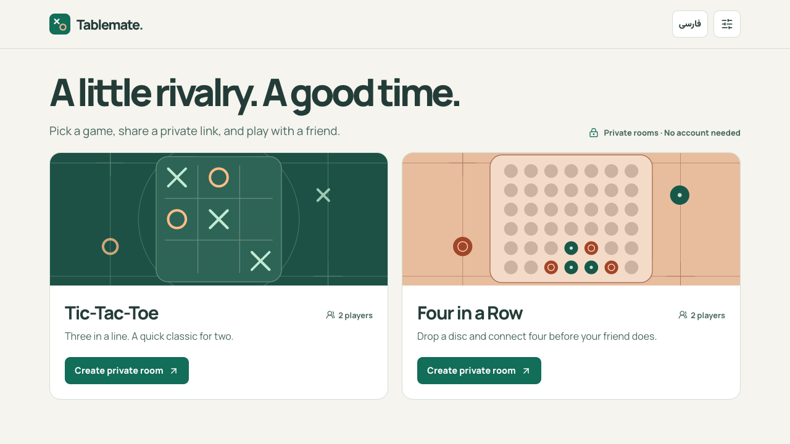
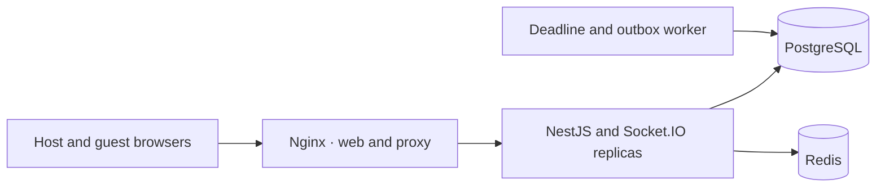

# Tablemate

Tablemate is a browser-based multiplayer platform for two friends. Play **Tic-Tac-Toe** or **Four in a Row** in a private room with an invitation link and no account. The host starts when both players are connected. The server validates every move and restores the current board after a refresh or reconnect.

[Quick start](#quick-start) · [Local development](#local-development) · [Architecture](#architecture) · [Testing](#testing) · [Project status](#project-status)



## Quick start

**Prerequisite:** Docker with the Compose v2 plugin. Run these commands from the repository root. The images install the workspace dependencies, build the web app, and migrate the database before the API and worker start. [Compose configuration](compose.yaml)

```sh
docker compose --profile replicas up -d --build
docker compose --profile replicas ps
```

Open [http://localhost:8080](http://localhost:8080). The `replicas` profile runs two API instances against the same PostgreSQL and Redis services.

### Play a match

1. Choose a game and select **Create private room**. A nickname is optional.
2. Open the invitation in a separate browser profile or private window and select **Join game**. The preview leaves the invitation available until the guest joins.
3. Return to the host window, wait for the guest to connect, then select **Start game**.
4. Select a square in Tic-Tac-Toe or a column in Four in a Row. The interface confirms moves as the server accepts them.
5. After the round, request a rematch from either window. Once the other player accepts, the host can start a fresh board with the starting roles swapped.

The same flow supports English and Persian, right-to-left layouts, keyboard controls, light and dark themes, and reduced motion. [Design and screenshots](docs/design/tabletop.md)

### Check or stop the stack

```sh
curl --fail --silent --show-error http://localhost:8080/health/ready
docker compose --profile replicas logs --tail=100 api api-secondary worker
```

The readiness endpoint returns HTTP 200 with `{"ok":true,"data":{"status":"ready"}}` when the selected API is ready. If startup stalls, check the migration logs with `docker compose logs migrate`. [Operations runbook](docs/operations/runbook.md)

| Address | Service |
| --- | --- |
| `localhost:8080` | Web app and same-origin HTTP and WebSocket proxy |
| `localhost:3000`, `localhost:3001` | Primary and secondary API endpoints for direct checks |
| `localhost:55432` | PostgreSQL |
| `localhost:56379` | Redis |

Run `docker compose --profile replicas stop` to stop the services and retain the PostgreSQL volume.

## Local development

Use **Node.js 24** to match Compose and CI, and **pnpm 10.28.2** from the workspace manifest. Enable Corepack with `corepack enable` if your Node installation includes it and the pnpm shim is unavailable. [Workspace manifest](package.json)

Stop the full Compose stack before running the API on the host, so port 3000 is available. On the first run, copy `.env.example` to `.env` and set `SESSION_REPLAY_KEY` to a random value of at least 32 characters. Generate one with `openssl rand -hex 32`.

```sh
pnpm install --frozen-lockfile
docker compose up -d --wait postgres redis

set -a
. ./.env
set +a

pnpm db:migrate
pnpm dev
```

Open [http://localhost:5173](http://localhost:5173). Vite serves the client and proxies HTTP and WebSocket requests to the API on port 3000. Run the migration and development commands in the shell where you exported the environment. [Vite config](apps/web/vite.config.ts)

| Variable | Purpose |
| --- | --- |
| `DATABASE_URL` | PostgreSQL connection string for the API, migrations, and worker |
| `REDIS_URL` | Redis connection string for Socket.IO and distributed rate limits |
| `PUBLIC_ORIGIN` | Comma-separated browser origin allowlist |
| `SESSION_REPLAY_KEY` | Encryption key for short-lived guest credential recovery. Share the same value across API replicas. |
| `PORT` | API port, defaulting to `3000` |
| `EXTERNAL_WORKER` | Set to `1` when running the separate worker |

For a quick UI session, `pnpm dev:fixture` runs the web app and a single API with in-memory storage. Fixture state disappears when the process stops. Use the two-replica Compose stack to verify persistence, cross-replica delivery, and recovery. [Environment template](.env.example)

## Architecture



The API authenticates the player and commits the move in PostgreSQL before acknowledging it. A command receipt lets the client retry the same command without applying the move twice. PostgreSQL notifications prompt other replicas to read and send the latest player-specific view. Redis provides distributed rate limits and the Redis Streams adapter for Socket.IO. The worker handles deadlines and republishes outstanding outbox notifications. [Architecture](docs/architecture/system.md) · [Storage decision](docs/adr/0002-aggregate-storage.md)

| Path | Responsibility |
| --- | --- |
| [`apps/web`](apps/web) | React and Vite client, localized game boards, and realtime UI |
| [`apps/api`](apps/api) | NestJS HTTP and Socket.IO entry points, room and match services, PostgreSQL migrations |
| [`apps/worker`](apps/worker) | Deadline processing, outbox publication, and retention |
| [`packages`](packages) | Shared contracts, pure versioned rules, game registry, design tokens, and test fixtures |
| [`infra`](infra) | Container image, reverse proxy, and monitoring dashboard |
| [`tests`](tests) | Cross-replica integration, browser workflows, and the local smoke workload |

Protocol references cover [HTTP endpoints](apps/api/openapi.yaml) and [Socket.IO events](docs/architecture/realtime.md).

## Testing

Run the local build checks after installing workspace dependencies.

```sh
pnpm lint
pnpm typecheck
pnpm test
pnpm build
```

With the two-replica Compose stack ready, run the integration and browser suites. Install the Playwright browser binaries before the first browser run.

```sh
pnpm exec playwright install chromium firefox webkit
pnpm test:integration
pnpm test:e2e
TABLEMATE_TEST_BROWSER=firefox pnpm test:e2e
TABLEMATE_TEST_BROWSER=webkit pnpm test:e2e
```

The default browser suite uses Chromium. Set `TABLEMATE_CHROME=1` to use an installed Chrome channel. Browser tests use separate contexts for the host and guest. Run `pnpm load:smoke` separately from the browser and integration suites. Set `TABLEMATE_SMOKE_ROOMS=50` for the paced 100-socket loopback workload. [CI workflow](.github/workflows/ci.yml) · [Recovery and load commands](docs/operations/runbook.md#local-qa-commands)

## Project status

The local verification run passed **21 unit and application tests**, **3 cross-replica integration tests**, and **12 browser tests** across Chrome, Firefox, and WebKit. A controlled restart preserved an acknowledged move. The paced loopback workload completed **50 rooms and 300 confirmed moves across 100 sockets**, with **37 ms p95** from submission to both the sender's durable acknowledgment and the opponent's update.

Production sign-off remains open for sustained load, manual accessibility and Persian language review, and full multi-seat platform testing. The verification report records the test environment and outstanding gates. The QA tracker records individual scenario results. [Verification report](docs/qa/verification.md) · [QA tracker](docs/QA_SCENARIOS.csv)

## Documentation and license

- [Product and engineering specification](docs/MEGA_PROMPT.md)
- [Acceptance scenarios](docs/QA_SCENARIOS.md) and [documentation index](docs/README.md)
- [Operations runbook](docs/operations/runbook.md) and [architecture decisions](docs/adr)
- [GNU General Public License, version 2](LICENSE)
