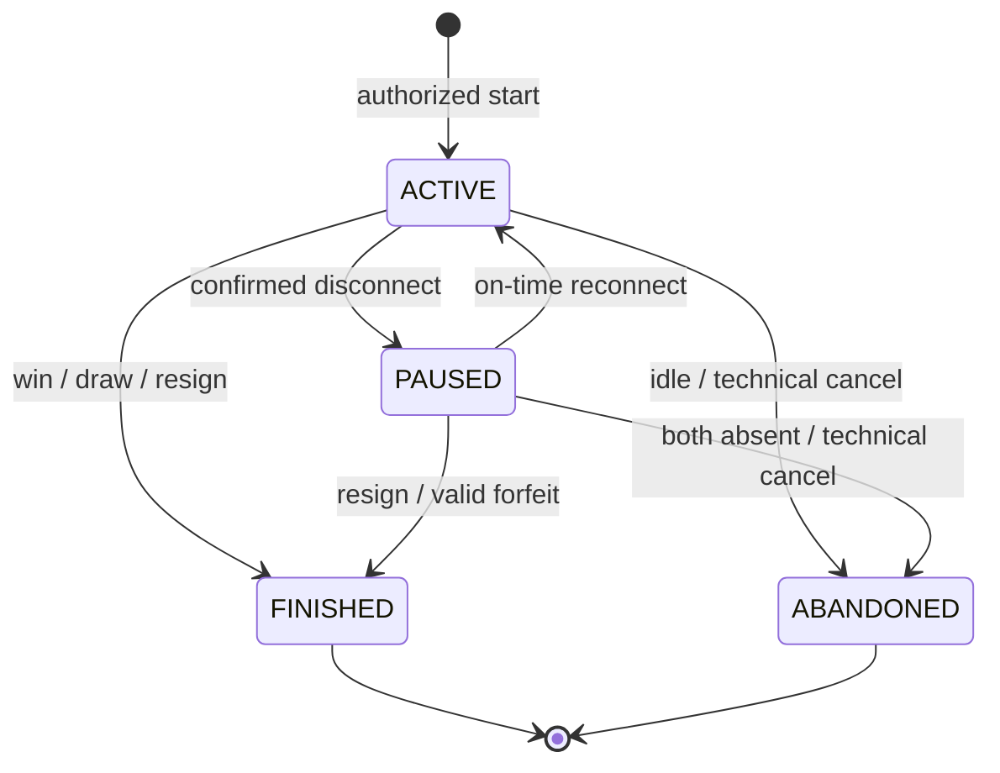
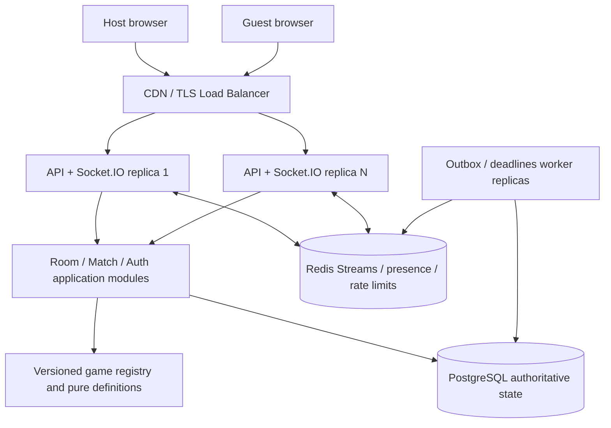

# Tablemate product and engineering specification

**Tablemate** is the working title for a browser game that two friends play in a private room. The host shares an invitation, the guest explicitly joins, and the host starts once both are present. The first release offers classic Tic-Tac-Toe and Four in a Row. The interface supports English and Persian, including right-to-left layouts. Engineering and design handoffs use English.

| Find a decision | Sections |
|---|---|
| Scope, timing policy and game rules | [Product requirements](#1-product-requirements) · [Rules and replay fixtures](#2-complete-game-rules-and-invariants) |
| Host and guest journeys, access and screens | [Lifecycle](#3-user-journeys-lifecycle-and-domain-boundaries) · [Design brief](#design) |
| State ownership, transactions and wire contracts | [Architecture](#5-architecture-and-technology-decisions) · [Persistence](#6-repository-persistence-and-transactional-design) · [Protocol](#7-api-and-real-time-protocol-contracts) |
| Privacy, load and release evidence | [Security](#8-security-privacy-and-abuse-resistance) · [Operations](#operations) · [QA](#10-testing-and-quality-engineering) · [Milestones](#milestones) |

## 0. How to use the specification

The assignment sets the scope. During a documentation review, edit the requested documents and validate their consistency. The implementation milestones describe future work. During an authorized build, inspect the existing repository and its instructions, preserve unrelated work and use the following gates.

1. Record product and architectural decisions with their rationale. Use the defaults here unless a documented constraint requires a change. Clear the working title for public use and record asset licenses.
2. Establish the player journeys, design references and accessible interaction states before building the corresponding features. Modern Tabletop is the default direction. Pause for design approval when the assignment requests it.
3. Deliver vertical slices with the test cases attached to each milestone. Use synthetic fixtures in labeled previews and actual server data in user flows. The [QA matrix](QA_SCENARIOS.md) owns test definitions and the [tracker](QA_SCENARIOS.csv) owns run results.
4. Record what was observed, the environment, commands, artifacts and unresolved defects. The [skills manifest](SKILLS_MANIFEST.md) supplies optional specialist workflows. Public deployment, spending and expensive infrastructure tests require explicit authorization.

### 0.1 Release decision

| Review area | Available points | Evidence used to score it |
|---|---:|---|
| Product, visual design and UX | 30 | Reference-to-browser comparisons, both locales, keyboard and screen-reader journeys |
| Modular architecture and extensibility | 20 | Dependency boundaries, pinned-version replay, private 3/4-seat contract fixture |
| Rules and correctness | 15 | Legal histories, terminal ordering and independent oracle agreement |
| Performance and scale | 15 | Measured workload, latency, resource use and invariant checks at the claimed stage |
| Security and reliability | 10 | Access/projection review, recovery and fault evidence |
| Tests and maintainability | 10 | Reproducible runs, traceability to QA IDs and build from a clean checkout |

Record points earned, the reason and supporting evidence in each row. Target at least **90/100** overall and **25.5/30** for product, visual design and UX (26 if scoring in whole points). Unverified criteria earn no credit. A score cannot override a failed release gate. Corruption, a lost acknowledged move during ordinary process failure, wrong winner, unauthorized access, missing core multiplayer flow, inaccessible critical path or unusable mobile board blocks release. Track exploitable high/critical security findings to a fix or an explicit risk acceptance by the accountable owner. See M6 for handling incomplete evidence.

## 1. Product requirements

### 1.1 Purpose and audience

Two friends should be able to start and finish a game on their phones or desktops without installing software or creating registered accounts. The catalog introduces the two games and explains who can join a private room. Casual players, families and board-game fans are the initial audience hypotheses.

The host can share a link and tell when the guest is ready. The guest knows who starts the game. During play, each player can identify their role, turn and legal actions. After an interruption they can recover the confirmed board or see the final outcome. After a finished round they can play again together.

### 1.2 Scope and prioritization

| Priority | Required capabilities |
|---|---|
| P0: release scope | Two classic games, guest sessions, pre-play nicknames and a catalog. Private rooms with single-use invitations, explicit join, live arrival, host Start, accessible boards and rules. Turn, last move, results, resign, mutual rematch and reconnect. Original 2D design, optional audio, reduced motion, EN/FA, RTL and light/dark/system themes. Multi-replica backend, security, operational and test evidence. |
| P1: evaluate after launch | Optional registered accounts, personal history, custom turn timers, limited preset reactions, installable PWA (online play), safe short invitation codes, read-only replay, additional game options and themes, user-requested accessibility settings. |
| P2: explicitly excluded | Chess, bots/AI opponents, public matchmaking, unrestricted chat, voice/video, public spectators, ranking, payments, gambling, tournaments, native applications, 3D, physics engine, persistent offline moves, elaborate social networks, speculative microservices. |

The catalog must show only the two enabled games. Future capabilities in types and extension points are not exposed as working UI. Production builds must never expose the test-only games or debug endpoints.

### 1.3 Success measures and research

Measure the invitation journey for consenting users. Use `catalog_viewed`, `game_selected`, `room_created`, `invite_copied`, `invite_shared`, `join_completed`, `room_ready`, `match_started`, `first_move_committed`, `match_finished`, `rematch_consented`, `rematch_started`, `reconnect_attempted` and `reconnect_restored`. Copy/share success reflects a successful browser operation. Join and game events reflect committed transitions. Emit `room_ready` on a transition into READY. Deduplicate retries by non-secret event IDs within the permitted retention period.

| Question | Measurement |
|---|---|
| How often do invitations become games? | Cohort by UTC room-creation day. Divide rooms with a first match start within 24 hours of creation by all eligible created rooms. Wait the full observation window before publishing a cohort. |
| Where do players wait? | Report median and p95 times from room creation to the first guest join, and from first verified READY to first match start. Report the number reaching each step alongside the timing. |
| Do players finish and play again? | For starts observed for 24 hours, report FINISHED, ABANDONED by reason, and still active/paused. For FINISHED matches observed for 24 hours, report the fraction followed by a same-roster rematch start. |
| Does recovery work? | Count a reconnect episode once across repeated attempts. Report the fraction restored to an authorized snapshot within grace, time from transport restoration to snapshot, and unresolved/expired episodes separately. |
| Which operations fail visibly? | For each operation, divide user-visible failures by distinct attempted intents. Separate correct validation feedback, rate limits and unexpected service faults. |

Keep nicknames, room links, credentials and private board state out of analytics. Collect necessary operational metrics separately. Product reporting should identify cohort size, observation window and consent coverage.

For the exploratory usability study, invite at least five people to try host and guest tasks on phone and desktop. Ask them to select a game, share or open an invitation, start, identify the turn, play, find the rules, reconnect, interpret the outcome and request a rematch without coaching. Record completion, first-click errors, time and points of confusion. If participants are unavailable, label human research NOT RUN and record a separate expert walkthrough.

### 1.4 Online play policy

Use a validated central `PlatformPolicy` config with injectable clock and documented defaults. Times below are product decisions, not traditional board-game rules.

| Area | Required MVP policy |
|---|---|
| Guest identity | Server-generated stable principal; opaque HttpOnly session cookie. Nickname is not identity; allow duplicate names. Validate 1–24 visible grapheme clusters after trim/normalization, at most 256 UTF-8 bytes after NFC normalization; reject control characters and unsafe bidi controls, never render as HTML. Allow legitimate Persian shaping characters such as ZWNJ; do not indiscriminately strip script-required characters. Use isolation in the UI. |
| Guest session | Default seven-day session, bounded renewal during authorized activity; distinguish session expiry, revocation and temporary network loss. No mandatory email/password. Explicit deletion/revocation flow. |
| Room | Private; selected game and version immutable once a match starts. Current games require exactly two distinct users, capacity 2. At most one active room membership per principal in MVP, at most one ACTIVE/PAUSED match per room. Support future seat lists and configurable supported player counts. |
| Invite | Cryptographically random opaque token, at least 128 bits of entropy; hash stored, default TTL 30 minutes; one redemption for one empty seat. Preview/GET/link unfurl does not consume. Explicit authenticated Join does. Rotation/revocation only by host when eligible, invalidates old token. Existing member resumes without re-consuming token. Future multi-seat invitations must be policy-driven. |
| Host | The creator is host; only host may start the first game and subsequent rematches. No automatic host migration in MVP. Host disconnect is not host leave. Explicit host departure before a match closes the room; after a match, explicit host departure closes the room. |
| Ready | Both distinct seats filled and each has at least one currently valid connection, with health known. Guest explicitly joins; no additional Ready click. Start becomes enabled only after verified presence. Server rechecks eligibility at execution. |
| Starter | First match: choose initial seat once using server CSPRNG, persist role assignment and result of draw. X/A always opens; host may be either role. On a mutually agreed rematch with the same two participants, swap roles/starter. A new roster starts a new series. |
| Turn | Casual untimed turns in MVP. No pass, undo, hints, auto-move or AI substitution. Inactivity cleanup is separate from a competitive turn timer. |
| Pre-start disconnect | Retain seat for 120 seconds after confirmed last connection lost; guest expiry releases seat and revokes invitation, host expiry closes room. New legitimate connection before deadline resumes same seat. For either seat, the initial 120 seconds run from the committed reservation until the first verified room connection. Apply the same guest-release and host-close rules at expiry. |
| During match | On confirmed loss of the last connection for a participant, pause, preserve exact board/turn, reject new moves, record per-participant disconnect episode and 120-second server deadline. Resume when everyone reconnects before applicable deadline. Explicit resign is allowed while paused. |
| Expiry during match | If at deadline exactly one participant is verifiably present and the other is expired, present participant wins by disconnect forfeit; if both absent when first deadline is reached, abandon without winner. A valid on-time recorded reconnection must not lose because a worker ran late. If presence is UNKNOWN due to infrastructure failure, defer competitive forfeit; enter degraded mode and eventually resolve via audited technical-cancellation policy if recovery is impossible. |
| Idle | An OPEN room expires after 30 minutes. Start its clock on creation or return to OPEN. Reset on a committed guest join/leave, invite rotation, or changed rematch consent. For ACTIVE play, start a 10-minute clock on match start or confirmed resume and reset it on each accepted move. At expiry abandon without a winner. Suspend this clock while PAUSED. Reads, pings, subscriptions and duplicate commands reset neither clock. |
| Resign | Explicit confirmation; accepted while ACTIVE/PAUSED; opponent wins by resignation; terminal state immutable. Closing tab, navigating back, refreshing or losing network is not resign. During a match, leaving the room as a member requires the explicit resign flow or a policy-defined completion. |
| Rematch | After FINISHED only, both current participants consent, and only host Start creates a new match with a fresh match ID. One consent does not start. Decline or explicit departure clears consent. Disconnect disables start; retain consent during grace if membership unchanged. ABANDONED returns to lobby if room still valid; no direct rematch of an abandoned game. |
| Series | Room may host several sequential matches. Derive wins/draws from immutable outcomes and series/roster identity; no duplicate increments. A changed roster begins a new series. Show score only if relevant; no global leaderboard. |
| Multi-tab | Same authenticated principal occupies one seat. Every authorized tab receives view; only a valid command at the correct version applies. Last valid connection controls presence. Explicit leave/revoke affects all tabs. Provide informational multi-tab notice, not forced logout. |
| Retention | Initial proposals: match/action history 90 days, operational logs 7 days, subject to review and configuration; define receipt/tombstone retention longer than allowed retry horizon, invite expiry cleanup, backups, and guest deletion. No automatic deletion of active matches. |

Use UTC database time sampled after acquiring the relevant aggregate lock. A join or verified reconnect recorded strictly before `due_at` is on time. At equality, expiry takes precedence. Worker wake-up time and client timestamps have no bearing on that decision. Section 3.3 defines the tie and uncertainty rules.

## 2. Complete game rules and invariants

All coordinates are canonical, zero-based, top-left origin. Never mirror the logical board for RTL. Board game modules are pure; transport, identity, consent, pause, forfeit, resign and persistence are platform concerns. Each game declares allowed actions, supported player counts, schemas and version. Reject malformed input before touching state; invalid actions cannot change board, turn, result, version or score. Valid moves are irreversible, strictly sequential in the first two games, and terminal states cannot be played further. The server is authoritative even when the browser can compute previews or legal-action hints.

### 2.1 Tic-Tac-Toe (rules version 1)

**TTT-R01 — setup.** `gameId=tic-tac-toe`, 2 distinct seats, roles X and O, 3 rows × 3 columns, initially all null. X starts. Role is determined by server roster policy, not client selection or host status.

**TTT-R02 — action.** `PLACE_MARK {row, col}` where both are strict integers 0–2. No owner, mark, next turn, board, result or timestamp accepted from client. Derive mark from seat role. Place exactly one mark in selected empty cell. Occupied cell, out-of-range/fractional/string/null coordinates, extra fields, wrong turn, unrecognized action, paused/terminal match or unauthorized player are rejected with a stable error code and unchanged state.

**TTT-R03 — alternation.** X, O, X, O ... until terminal. No pass, undo, redo, duplicate move or replacement. If nonterminal, exactly one active seat; after terminal none. `legalActions` lists empty cells only for the active authorized player.

**TTT-R04 — wins.** Eight canonical lines: rows r=0,1,2; columns c=0,1,2; main diagonal `(0,0),(1,1),(2,2)`; opposite diagonal `(0,2),(1,1),(2,0)`. A line wins when all three cells equal the moving player's non-null role. Evaluate all eight after each move. Return all winning lines formed on the final move, ordered by row index, then column index, then main and opposite diagonal. Two simultaneous lines are one win, one terminal result, one score increment.

**TTT-R05 — draw and termination.** Evaluate win first, then draw if all 9 cells occupied, else switch active seat. Ninth move may be a win; never declare an early draw based on prediction or minimax. Earliest X win is ply 5, earliest O win ply 6. No moves accepted after a winning/drawn game.

**TTT-R06 — invariants.** X count equals O or O+1. Nonterminal next role follows counts; no existing winning line in a nonterminal board. Legal play cannot contain wins by both roles. Validate reachability by replay, not counts alone. MoveCount equals occupied cells. Last move exists iff at least one move has been accepted; it refers to the correct role and cell. No fake winning line for resign/forfeit. Check state on hydration and migrations; quarantine invalid data rather than silently repair or reset.

**TTT-R07 — state and result.** Proposed state `{board: (null|'X'|'O')[][], turnSeatId: SeatId|null, moveCount: number, lastMove: {row,col,seatId}|null, winningLines: Cell[][]}`. Role map and rules version are persisted with the match. `getResult` is deterministic; natural result is WIN/LINE_COMPLETED with one winner or DRAW/BOARD_FULL with none. Platform-level terminal outcome takes precedence over continued game play.

### 2.2 Tic-Tac-Toe legal replay fixtures

Cell index `i` maps to `(floor(i/3),i%3)`.

| Actions in alternating order | Expected terminal or validation result |
|---|---|
| `[0,3,1,4,2]` | X wins horizontally. |
| `[0,1,3,2,6]` | X wins vertically. |
| `[0,1,4,2,8]` | X wins main diagonal. |
| `[2,0,4,1,6]` | X wins opposite diagonal. |
| `[0,3,1,4,8,5]` | O wins horizontally. |
| `[0,1,2,3,6,5,8,7,4]` | X wins on ply 9 with two diagonals; one result. |
| `[0,1,2,4,3,5,7,6,8]` | Legal full-board draw. |
| `[0]`, then attempt same cell by O | CELL_OCCUPIED; O remains active; version unchanged. |
| Any terminal sequence followed by any action | MATCH_ENDED; no board or result mutation. |

Implement an independent oracle scanning all lines and a full legal-game DFS from the empty board (no symmetry reduction unless separately reported). Compare result/turn/legal actions on every reached node. Verify no action accepted after terminal, immutable snapshots, deterministic replay and all eight lines for both reachable roles. If testing geometry on fabricated boards, label it synthetic; do not call those boards reachable. Report the counts generated by the traversal. With distinct move histories and the empty root counted once, the reference totals are 549,946 nodes and 255,168 completed games. If memoizing by board, report unique positions separately.

### 2.3 Four in a Row (rules version 1)

**FIR-R01 — setup.** `gameId=four-in-a-row`, exactly two distinct seats, roles A and B, 6 rows × 7 columns, 42 cells, all initially null. Top row 0; bottom row 5; left column 0; right column 6. A starts; role policy as above. At most 21 discs per role. This is classic drop-disc play, not PopOut, variants or a timed mode.

**FIR-R02 — action and gravity.** `DROP_DISC {col}` where col is a strict integer 0–6. The server scans row 5 to 0 for first empty cell in that column. If none, COLUMN_FULL; no mutation or turn change. Only the server computes landing row and owner; reject attempts to specify a row, disc color, board or result. No sliding, removing, moving existing discs or floating pieces.

**FIR-R03 — alternation.** A then B until terminal. Exactly one disc is added per accepted move. `legalActions` lists only nonfull columns for active seat. Nonactive seat receives no legal moves. No pass/undo. UI column controls represent actual server action, never an arbitrary cell.

**FIR-R04 — directional evaluation.** Starting at newly placed disc `(r,c)`, examine axes `(dr,dc)=(0,1),(1,0),(1,1),(1,-1)`. Count contiguous same-role neighbors on both positive and negative directions, stopping at bounds, empty cell or opponent disc. A run wins if `1 + forward + backward >= 4`. No wrapping between rows/columns. Return each maximal winning run including the last move, ordered by the axis sequence above with cells sorted by ascending (row, column) within each run, rather than overlapping 4-cell windows. Runs of 5, 6 or 7 win as appropriate; multiple runs are one outcome. All four directions, corners and edge cases count.

**FIR-R05 — termination.** Evaluate win before draw; if no win and moveCount=42, DRAW; otherwise switch. Earliest A win ply 7, earliest B win ply 8. Ply 42 may be a B win. No early theoretical draw, no play after terminal. A full column can be focused/read but is not a valid action.

**FIR-R06 — invariants.** No empty cell beneath any placed disc. A count equals B or B+1. `moveCount` equals occupied cells. In a nonterminal state there are no winning runs by either role; turn consistent with counts. A legal terminal win must arise from final disc; verify through replay. A win by both roles is not reachable under legal history. Validate schema dimensions and allowed cells, reject malformed or unsupported historical state. JSON snapshot is sufficient at launch; do not prematurely implement bitboards/solvers.

**FIR-R07 — state and presentation.** State shape analogous to TTT with A/B and `lastMove: {row,col,seatId}`. Projection includes confirmed landing row and legal-column availability. Hover/touch preview shows the potential landing position without committing. Committed disc drop is animated only after server confirmation. Resync, rematch or out-of-order event cancels obsolete animations. All meanings conveyed by shapes/text/patterns as well as color. No invented winning line on forfeit/resign.

### 2.4 Four in a Row legal replay fixtures

All numbers are zero-based column indexes. Verify the intermediate positions and that the intended terminal result is the FIRST terminal result.

| Actions | Expected |
|---|---|
| `[0,0,1,1,2,2,3]` | A horizontal run on bottom row. |
| `[0,1,0,1,0,1,0]` | A vertical run. |
| `[6,0,6,1,5,2,5,3]` | B horizontal run. |
| `[0,1,1,2,4,2,2,3,4,3,5,3,3]` | A upward-right diagonal from `(5,0)` to `(2,3)`. |
| `[6,5,5,4,2,4,4,3,2,3,1,3,3]` | A mirrored diagonal. |
| `[0,0,0,0,0,0]`, then attempt column 0 | COLUMN_FULL; turn remains A. |
| `[0,6,1,6,3,5,4,5,2]` | A connects five by filling gap, one result. |
| `[0,0,1,1,3,3,4,4,5,5,2]` | A completes one horizontal run of six, bottom row, columns 0–5. |
| `[0,0,1,1,2,2,4,4,5,5,6,6,3]` | A completes one run of seven across the bottom row. |
| `[1,5,5,2,3,4,3,0,3,6,4,4,4,0,2]` | A lands at `(4,2)` on ply 15. Return the horizontal run `(4,2)–(4,5)` and diagonal `(2,4)–(5,1)`, in that order, with one win. |
| `[3,1,6,5,4,5,5,4,4,3,4,2,3,1,1,1,2,2,1,3,6,1,5,3,0,6,6,0,4,3,6,0,6,4,2,0,0,5,2,5,2,0]` | 42-ply legal draw. |
| `[2,4,3,3,4,0,1,4,0,1,3,5,6,4,0,2,1,5,0,0,0,6,1,2,6,2,6,1,6,1,3,5,4,4,5,6,2,2,3,5,5,3]` | B wins on ply 42 (not draw). |

Use property-based generators that choose only legal columns and stop at terminal. Record seeds. Compare incremental last-disc scan with independent exhaustive scanning of every contiguous four-cell window across the entire grid. Test reflection symmetry (reverse columns and expected run), all edge axes, interrupted lines, maximal runs, multi-axis wins, full columns, malformed coordinates, postterminal actions and replay/hash consistency. Construct reachable fixtures where practical, distinguish synthetic geometric tests, and never mutate original snapshots.

## 3. User journeys, lifecycle and domain boundaries

### 3.1 Primary experience and sequence

1. Host opens catalog, selects game, enters nickname only if needed, creates private room. Server commits guest/session as applicable, room, host seat and invitation. Host sees game preview, empty second seat, copy/share, clear disabled Start with explanation. The link has no player information or reusable session credential.
2. Guest opens invitation landing route, previews limited safe metadata, enters name if needed, explicitly joins. Link preview bots never join. Server verifies token, membership, room eligibility, capacity, then atomically consumes token and adds guest seat. Guest subscribes using authenticated session; after both are verifiably present, server computes readiness. Host sees guest arrive without refreshing. Guest sees waiting-for-host text, not a fake Start button.
3. Host presses Start. UI indicates pending, does not navigate speculatively. Server rechecks host, roster, exact allowed capacity, readiness, current room version and consent if rematch, commits match and role allocation. Publish event after commit. Both clients subscribe to same match ID and receive their own authorized snapshots. If start event missed, room snapshot contains currentMatchId.
4. During play, only authorized active seat can make an action. Client sends a strict typed command with expected version, unique ID; server validates, commits, ACKs, delivers versioned views to both. Client renders confirmed board, turn and outcome; animation is presentation, never source of truth.
5. Terminal state stays visible. Display personalized win/loss/draw/abandoned, reason, final board, natural winning lines only, series results. One participant requests rematch, other accepts; host explicitly starts next match when both ready. Keep previous match immutable.
6. Any refresh, temporary disconnection, delayed ACK, missed event, or node restart triggers a safe recovery path: authenticate, subscribe, sync latest authorized snapshot, reconcile outstanding command, resume or show final result. No tab-close resign. No stale board becoming interactive before sync.

### 3.2 Separate state machines

Room durable status: `OPEN | PLAYING | CLOSED | EXPIRED`. OPEN has derived readiness (`WAITING | READY | REMATCH_WAITING | REMATCH_READY`), calculated from roster, eligible presence, series context and consent. PLAYING links to exactly one ACTIVE/PAUSED match. On completion, clear `currentMatchId`, retain `lastMatchId` and return the room to OPEN if still valid. Persist completion and the room pointer change in the same transaction. CLOSED/EXPIRED are terminal; no join/start. Any room/match coupled transition commits atomically. Avoid a persisted unguarded boolean `ready`.

A match starts ACTIVE. Confirmed loss of the last valid connection for a required seat pauses it. Recovery restores the preserved turn when all required seats return on time. The diagram lists the permitted exits for each state. A terminal transition advances `stateVersion` once and freezes the board and result. A natural winning or drawing move and its result share that transition.

Presence is independent of membership: `CONNECTED | DISCONNECTED | UNKNOWN`, per-principal connection leases, revision, generation and durable disconnect episode. A socket may be connected but unauthorized/not subscribed; it cannot automatically make a room ready. A member may temporarily have zero sockets. Treat stale disconnect and stale deadline as no-ops. Client health states: `INITIALIZING | SYNCING | LIVE | PENDING_COMMAND | RECONNECTING | DEGRADED | SESSION_EXPIRED`, separate from durable match state. Disabled controls derive from both layers and legal actions.



### 3.3 Boundary and precedence rules

Serialize conflicting transitions under the aggregate lock. Evaluate already-due policy transitions first. Record a due transition with its own system identity, receipt or unique job key and outbox event, even when the triggering user command must be rejected. A rejected user command contributes zero moves, outcomes or score. Use the first valid commit for simultaneous player commands when no deadline takes priority.

| Boundary | Decision and observable result |
|---|---|
| Reconnect versus disconnect expiry | Reconstruct verified presence at the first applicable cutoff. One player present and the other expired gives a forfeit. Both absent gives ABANDONED with no winner, including equal deadlines. A later reconnect may read the outcome. |
| Infrastructure uncertainty | Fence Start and moves while required presence is UNKNOWN. Display degraded status immediately. If authoritative history covers the cutoff, resolve using that history. If a gap makes the cutoff unknowable, discard that competitive deadline. On recovery resume when all are verified present, or grant a fresh 120-second grace from the first reliable observation for each absent seat. If state cannot be safely recovered, an authorized operator records an audited technical cancellation with no winner. |
| Idle, lobby and seat expiry | Apply the earliest due transition for the current state. At equal instants, room expiry closes an OPEN lobby as EXPIRED before seat cleanup. In ACTIVE, a disconnect confirmed before the idle cutoff pauses the game. At the idle cutoff, an already-due idle transition takes precedence. An obsolete job checks its generation and exits. |
| Terminal match to lobby | Record the terminal outcome once. Clear rematch consents. For any absent seat still in the OPEN room, start a fresh 120-second lobby grace at completion. Active-match and lobby timers have distinct generations. |
| Next round | After FINISHED, the same roster needs both consents and host Start. Swap roles and retain the series score. After ABANDONED, show the neutral result and offer a return to the lobby. Ordinary host Start with two present players draws fresh roles. The same roster retains its series totals and abandonment adds no win or draw. A seat leaving and being replaced starts a new series with zero totals, even if a previous guest later rejoins. |
| Explicit session revocation | Revoke access and fence sockets for that session. If the seat loses its last valid connection, use the ordinary disconnect policy. Revoking a session, closing a tab and navigating away never submit a resignation. A new principal with the same nickname has no claim on the old seat. |

Match status and client sync status are independent. A local loss may freeze one board before the server detects the last connection loss. A reconnecting player can act only after applying an authorized snapshot and receiving an eligible active view. Preserve the game's stored next seat across a pause. Expose no actionable seat or legal action in a paused or terminal view. The result represents winners as an array so future games can represent teams or ties.

### 3.4 Error and recovery requirements

When a room closes or expires, release all active memberships, clear consents, invalidate invitations and fence live subscriptions in the closing transition. Affected principals can create or join another room. Send a closure notice containing only a safe reason to previously connected members, or let them reconcile via /me after live access is fenced. A rejected command has no player-authored effect. A separately due system transition can change the version during its evaluation (§3.3). Display actionable, localized messages. For invalid/expired/revoked/consumed invites or room full, preserve privacy and offer request-new-link or catalog; do not leak occupants or whether an arbitrary private ID exists. Existing-member link reopening returns their own seat if authorized. For clipboard or share failure, expose selectable link and honest manual copy fallback. For session expiry, stop commands, show clear recovery, never regain a seat by claiming same name. For stale state, resync rather than replay on new version. For pending timeout, do not infer failure; retry same command ID and same payload or query receipt/snapshot. For rate limiting, display retry guidance without rapid loops; for overload, preserve acknowledged state and surface degraded status. Explicit leave/resign/delete confirmation only for consequential actions, never a browser-close penalty.

<a id="design"></a>

## 4. Product design and art direction

### 4.1 Design deliverables before feature implementation

Before implementing a feature, record its design reference in `docs/design/`. Foundation and test setup may proceed alongside design.

| Deliverable | What the reviewer should find |
|---|---|
| Brief and journeys | Audience hypotheses, host/guest tasks, sitemap, screen/state inventory and the decision required of each player at each step. Cite any pattern research. |
| Visual direction | Moodboard, three distinct directions applied to the same lobby and board, original artwork and a documented choice. Keep source art, licenses and reference screenshots distinguishable. |
| Screen references | Low-fidelity wireframes followed by readable high-fidelity references for the primary screens and exception states in §4.5, covering phone and desktop layouts. |
| Interaction and language | Tokens, component variants, keyboard/focus behavior, motion, EN/FA copy, accessibility assessment and screenshot comparison plan. All labels and controls in the product are semantic text. |

Use the available design tool or original SVG/HTML/CSS mockups rendered locally. Evaluate clarity and legibility (25%), identity (20%), emotional fit (15%), mobile use and accessibility (20%), extensibility (10%) and asset/rendering cost (10%). Record the basis of each judgment. Keep reviewer opinions distinct from participant findings.

| Direction | Visual concept | Risks and mitigation |
|---|---|---|
| Modern Tabletop (default) | Calm forest-green/cream palette, tactile flat 2D geometric board, mint vs copper marks, fine-line icons, minimal chrome, intentional negative space, warm friendly copy. | Low contrast or monotony if colors are over-muted; enforce contrast and distinct shapes. |
| Paper & Ink | Warm off-white paper-like surface, ink-blue and burnt-orange marks, crisp editorial type, clean drawn linework. | Noise or hand-drawn decoration must not obscure cells. Avoid expensive textures. |
| Arcade Geometry | Deep ink/navy canvas, blue and golden pieces, precise angular geometry, more lively but restrained motion. | Risk of neon/casino aesthetics and visual fatigue; limit saturation, no flashing, no excessive effects. |

Select Modern Tabletop unless a documented constraint merits change. Aim for a contemporary consumer-quality experience: one clear creative idea, cohesive page rhythm, meaningful whitespace, distinct board art, graceful feedback. Avoid generic template dashboards, repetitive nested cards, purple AI gradients, giant pill badges, glassmorphism, neon glows, photorealistic or 3D boards, excessive shadows, game monetization tropes, confetti everywhere, emoji as primary UI icons, fake player statistics, and decorative widgets that compete with the board. Design for a friend's game night, not a productivity app.

### 4.2 Brand and art system

Define brand attributes: approachable, fair, quietly playful, intelligent, tactile without mimicking depth. Create at least three original logomark explorations based on two interacting geometric pieces or a simple tabletop grid. Choose one that works at 16px favicon, 24px navigation, 48px avatar, monochrome and dark/light. No trademarked game logos. Wordmark is real text or original vector lettering with an asset/license record. Prepare wordmark, logomark, monochrome lockups, favicon, two catalog thumbnails, 2D board graphics, reusable avatar generator or curated abstract avatar set, original X/O and A/B pieces, last move marker, winning connector, empty-seat illustration and result illustrations only if they add value. Provide SVG source with viewBox and minimal paths; optimize assets and sanitize any third-party SVG. Do not introduce sprites, terrain, physics, parallax or an always-running game loop for these static board games.

Use consistent geometry: X is two rounded or squared-ended diagonal strokes with optical alignment; O is a distinct ring with matching visual weight, not a filled disc that becomes hard to distinguish. Disc A has a single dot/solid center mark; disc B a double ring/stripe or distinct center motif. Make motifs legible at smallest board size; provide high-contrast fallback. Use shape identities consistently in avatars, seat cards, board, accessibility labels and result panel. Avoid red/green good-vs-bad coding for the two players. A/B colors fixed within a match; role swap in rematch explicit. Do not communicate a player's identity by screen side alone. Create vector thumbnails that show legal game positions and no misleading simultaneous winners. If an illustrative image is decorative, alt is empty; if instructional, describe board pattern.

### 4.3 Color psychology, accessibility and tokens

Treat color associations as contextual design hypotheses, not causal guarantees of trust, engagement, calm or behavior. Cooler/green tones may support a restrained visual mood; warm copper adds contrast and friendliness; use neutral backgrounds to reduce visual competition. Test with real people if available, and across cultural contexts. Keep semantic success, danger, warning and focus tokens separate from player identities. Neither player should be made to appear inherently winning, threatening or inferior by color. Never depend solely on color, sound, motion or position for game state.

Starting palette (validate all rendered foreground/background pairs and interactive states; change with a documented contrast decision if needed):

| Semantic token | Light | Dark | Purpose |
|---|---|---|---|
| background | #F5F4EE | #142724 | Main calm canvas |
| surface | #FFFFFF | #263E3A | Content/controls |
| text | #243C37 | #F2F7F4 | Primary text |
| text-muted | #46665C | #B4C9C1 | Secondary text |
| border-strong | #66847B | #8CACA1 | Required control boundaries |
| primary | #126D59 | #77DFBE | Main action |
| on-primary | #FFFFFF | #142724 | Primary button label |
| piece-a | #126D59 | #77DFBE | X/A, also distinct motif |
| piece-b | #A14B22 | #FFBD83 | O/B, also distinct motif |
| board | #E4EDE7 | #395B55 | Board frame |
| board-cell | #F8FBF8 | #172C2A | Empty slot |
| success-text | #19663F | #9BE3AF | Positive feedback, with text/icon |
| warning-text | #85520B | #FFD18B | Connection warning |
| danger-text | #A3293C | #FFB2BD | Error/destructive intent |

Extend with tokens for `surface-raised`, `overlay`, `border-subtle`, `focus-inner`, `focus-outer`, `link`, `disabled-bg`, `disabled-text`, `hover`, `active`, `pending`, `piece-outline`, `winning-line`, `last-move`, and corresponding on-colors. Produce a matrix of actual combinations for normal, hover, focus, pressed, disabled, warning, theme and board state. Measure WCAG 2.2 AA targets: normal text >=4.5:1; qualifying large text >=3:1; meaningful non-text controls/graphics >=3:1 against relevant adjacent colors. Example palette contrasts from the prior specification: light text on light background about 10.73:1; dark primary text on dark background about 14.41:1; light on-primary on light primary about 6.25:1. These are spot checks, not conformance evidence. Use two-tone focus outline if required; keep focus visible and unobscured. Test grayscale, protan/deutan/tritan simulations, forced-colors/high-contrast modes and actual keyboard use. Use pattern/shape/text redundantly. Distinguish success from player A even when hues are similar. Use semantic tokens via CSS custom properties; never scatter raw color literals across feature CSS. Export token JSON/CSS and a human-readable specimen; show both themes side by side.

### 4.4 Typography, iconography, spacing and component geometry

- Typography: English Manrope or comparable licensed geometric/humanist sans; Persian Vazirmatn or comparable OFL Persian family, system fallbacks. Verify license and glyph coverage, self-host subset WOFF2 where allowed; limit weights and preload only critical files. Respect Persian joining and ZWNJ. Use `lang`, `dir`, `bdi` for nicknames and `dir=ltr` for URLs, codes and canonical game coordinates. Do not use visual truncation for critical status/error text. Wrap long names and reserve readable space for status. Tabular numerals for countdown and score; consistent localization of display numerals and stable canonical numeric input.
- Type scale (CSS px/rem equivalents, user zoom supported): 12/14 captions; 16 controls/body; 18/20 subhead; 24/32 screen heading; 36–40 large catalog heading only when appropriate. English line height ~1.45–1.6, Persian ~1.6–1.8. Use at most 3 purposeful weights; never make text tiny to fit. Critical turn/status label 16–20 and visually dominant over secondary room metadata.
- Spacing scale: 4/8/12/16/24/32/48/64px. Mobile shell gutter 16px (12 at very narrow widths if required), tablet 24, desktop 32; max shell 1200px. Desktop 12-column layout, mobile 4-column responsive grid; the board itself has exact logical dimensions. Radius 8/12/18 for controls and surfaces, game pieces custom geometry. Limit to two purposeful elevation levels; flat 2D layering with subtle borders, not simulated 3D. Consistent icon family such as Lucide (check license), 16/20/24px, consistent stroke, no mixed outline/filled styles without semantics. Every icon-only control has accessible name, focus and sufficiently large target.
- Button hierarchy: primary filled only for the principal action per state; secondary outline/text for sharing, rules, settings; destructive text/secondary with confirmation. Do not hide essential labels behind unexplained icons. Include spinner + stable label, avoid layout shift when pending. Disabled appearance must still show legible reason and not invite ineffective clicking. Tooltip is supplementary, never the only way to discover an explanation.
- Components: implement reusable semantic primitives `Button`, `IconButton`, `TextField`, `Dialog`, `Drawer`, `Toast/InlineNotice`, `Skeleton`, `GameCard`, `PlayerSeat`, `PresenceLabel`, `InviteField`, `TurnBanner`, `BoardFrame`, `BoardCell`, `ColumnControl`, `Disc`, `WinningRun`, `ResultPanel`, `SeriesScore`, `ConnectionBanner`, `RulesContent`, `SettingsPanel`. Each has documented anatomy, props, tokens, variants, keyboard behavior, accessible name/state, responsive sizing and test coverage. Use accessible Radix/shadcn primitives only if useful; customize visual skin; no default library look. Maintain Storybook or equivalent local component gallery with every state including long text and themes; clearly distinguish mock previews from production.

### 4.5 Information architecture and screen-by-screen implementation contract

Routes: `/` catalog; `/games/:gameId` optional explanatory/select view (no fake play); `/join#token=...`; `/rooms/:roomId`; `/matches/:matchId`; `/privacy`; error/session recovery. Settings/rules can be dialogs/drawers, not extra pages if unnecessary. Authorization on every private route. Deep links after refresh recover latest view without redirect loops. Use browser history intentionally: Start replaces or navigates once from room to match; a room route during an active match offers/redirects to that match after verified authorization; finished-match deep link shows authorized immutable result; back navigation never implicitly leaves membership. Never depend on in-memory navigation state for access or recovery.

| View | Required hierarchy and actual behavior | Required visual/interaction states |
|---|---|---|
| Catalog | Quiet top bar (brand, language, theme). Clear headline, short private-play explanation, exactly two original board thumbnails, game name/player count/description, create CTA per game. Short how-it-works, privacy footer. No fake user counts, sales pitch or inactive chess. | Loading skeleton dimensions stable; both available; one disabled with reason; catalog error/retry; offline; keyboard focus; mobile. |
| Create room | Game summary and rules link, nickname field only if needed, explicit Create private room. Current active membership recovery with confirm/return; never silently leave a current game. | Initial, valid, validation, submitting, retry/uncertain ACK, success route, session expiry, existing room. |
| Invitation landing | Game illustration/title, concise explanation, optional name, Join game primary. Do not reveal members or private data before authorization. No sign-up hurdle. | Checking invitation, valid, invalid/revoked/expired/consumed, full, already member, active other room, submitting, lost network, rate limit, retry. |
| Waiting room (host) | Game title, two seats (host and guest), capacity, presence, link field Copy + Share, Start primary with explicit disabled reason. Rules, safe leave action. Host name and seat, invitation status/expiry if useful. | Empty seat, guest joins but not connected, both ready, guest disconnect, grace countdown, expired guest seat, rotate confirmation, pending start, closed/expired, degraded. |
| Waiting room (guest) | Same game and seats; visible host label; waiting-for-host text replaces Start. No invite rotate, no fake Start. Leave available. | Joining, waiting for presence, ready/waiting for host, host disconnected, host reconnect, start event, closed/expired, degraded. |
| Gameplay (shared shell) | Small header with back/rules/settings; player identities and roles; central turn banner; large board; last action/status, minimal series score; secondary resign. Keep board dominant. | Initial sync, own turn, opponent turn, command pending, validation error, stale version, local offline, partner offline/pause, unknown infrastructure health, resume, terminal. |
| TTT board | True square 3×3 grid. Empty cells, original marks, last-move indicator, win connector(s) overlay with no hit interception. Keyboard navigation and accessible cell names. | Empty, available hover, focus, occupied, pending, win single/multiple, draw, paused, terminal, reduced motion. |
| FIR board | True 7:6 grid with seven explicit column selectors; empty holes, distinct patterned discs, potential landing preview, last-disc marker, maximal run connectors. | Empty/partially filled/full columns, focus, valid preview, pending, committed drop, long/multiple wins, draw, resync. |
| Result | Preserve final board and role cards; personalized outcome/reason; clear next action Rematch or return to lobby. No fake line on nonnatural outcomes. | Win, loss, draw, resign, forfeit, both absent, idle, technical cancellation; consent requested/accepted/declined; partner left; start pending; new roster. |
| Rules | Concise illustrated legal play, win/draw examples, online pause/forfeit policy separate. Accessible dialog/drawer. | Open/close, Esc, focus restored, scroll content, mobile, EN/FA. |
| Settings | Language, theme (system/light/dark), sound toggle, reduced motion preference. Preferences non-sensitive and persist locally. | Saved, browser storage denied, changing during game, no audio permission. |
| Recovery/error | Friendly plain-language explanation, one actionable recovery, catalog/room return as appropriate. | Session expired/revoked, unknown/private room, incompatible renderer/rules version, maintenance, offline, overload, generic retry. |

For every row create state-specific mockups and acceptance screenshots for both roles as needed. Minimum primary design concepts: catalog, create, invite landing, waiting host with empty seat, waiting host ready, guest waiting, each game with own/opponent turn, disconnected/pause, each natural result, rematch waiting, mobile versions; document error and settings variants. Do not rely on a single landing-page hero mockup. Every interaction visible in a concept must map to actual implemented behavior or be removed. Preserve agreed visual direction in code; compare latest browser screenshots to reference and fix discrepancies.

### 4.6 Responsive and layout blueprints

| Viewport | Layout and controls |
|---|---|
| Phone, 320–767 CSS px | Order content as player identities, turn/status, board, controls and result. Stack identities if names wrap. Allow natural vertical scroll. Account for safe-area insets, short heights and the nickname keyboard. |
| Tablet, 768–1023 CSS px | Keep the board centered and the turn immediately above it. Use extra width for the seat cards only when both names and roles remain legible. Preserve board geometry on rotation. |
| Desktop, ≥1024 CSS px | Use a shell up to 1200 px wide and a navigation bar around 64 px tall. Keep the board the largest element. TTT is square, up to about 440 px wide. FIR is 7:6, up to about 560 px wide plus controls. Keep resign away from play input. |

Test widths **320, 360, 390, 430, 768, 1024, 1280, 1440 and 1920 px**, landscape, short heights, 200% zoom, reflow and safe areas. At 320 px, maximize the width of each FIR column target and aim for at least 44 px height. Check the applicable 24 CSS px target-size or spacing criterion with the rendered gutters. A column's whole tap region selects that column. In Persian, mirror the surrounding layout using logical CSS properties and keep the physical board left-to-right.

### 4.7 Input semantics and accessibility

| Interaction | Keyboard and assistive-technology contract |
|---|---|
| Enter, inspect and leave TTT | Use a semantic grid with one tab stop on entry. Arrow keys move one physical cell and stop at an edge. Tab or Shift+Tab leaves the grid. Enter/Space submits a legal focused cell once. Occupied cells remain discoverable with the arrows. Announce one-based row, column and occupant. |
| Inspect and play FIR | Provide seven column controls with a readable column number and spaces remaining or full status. Enter/Space drops in a legal column. A board summary or row/cell reading view lets a player inspect the whole position without tabbing through 42 slots. |
| Receive a game update | Keep focus on the player's current control after remote moves, animation, reconnect and language/theme changes. Announce arrival, confirmed move, turn, pause, resume and result through concise live updates. Do not announce heartbeat or countdown ticks. |
| Open and dismiss a dialog | Give the dialog a title, an accessible description, intentional initial focus and a reachable close action. Contain Tab inside an open modal. Escape dismisses without submitting and returns focus to its trigger or a logical successor. |
| Read a disabled or pending action | Expose its reason as persistent text. Keep the board inspectable during a pending move, pause and terminal state. Pair color, sound and motion with text or shape. |

Use DOM/CSS Grid and SVG with keyboard-operable semantics. Verify both boards manually with a screen reader, keyboard and touch, forced colors, reduced motion and zoom. Record the assistive technology, browser and actual announcement. The target is WCAG 2.2 AA with documented evidence and outstanding limitations.

### 4.8 Interaction, motion and audio specification

| Trigger | Expected feedback and timing (proposed, tune with device testing) |
|---|---|
| Hover (fine pointer only) | 100–140ms subtle background/outline and ghost mark/landing preview; no state change. No hover dependency on touch. |
| Press/tap | Immediate pressed/focus affordance, then pending command marker; do not add a confirmed piece before server commit. Disable further input for that client's pending command, preserving inspection/navigation. |
| TTT committed mark | 120–180ms scale/opacity or stroke reveal with stable layout; final board/state already authoritative. |
| FIR committed disc | 180–320ms distance-adjusted vertical translation using transform/opacity; final position from server; no physics loop, no overshoot causing false cell. |
| Opponent joins | 140–220ms seat transition plus polite announcement; Start enablement only from authoritative readiness. |
| Turn changes | Immediate text/shape/outline change, optional 120ms transition; no color-only cue. |
| Winning line | ~220–350ms connector or highlight, retains final board and clear result; multiple maximal lines supported. No flashing; no fake line on disconnect/resign. |
| Draw/loss | Calm restrained result panel, respectful copy; no punitive animation. |
| Disconnect | Persistent inline banner with status and server deadline countdown if available; disable play, preserve board. Do not fabricate countdown during UNKNOWN. |
| Resync/route change | Cancel all obsolete animation/preview queues; snap to newest validated snapshot; don't replay old sounds or win animation repeatedly. |
| Reduced motion | Replace all nonessential transitions with immediate updates or brief opacity only if suitable. No required motion for comprehension. |

Motion tokens `duration-fast=120ms`, `normal=180ms`, `slow=280ms` and purposeful easing (e.g. deceleration for appearance). Keep animations compositor-friendly; no continuous particle/background loops. Audio optional and muted by default, enabled only via explicit user gesture. Create or license short quiet sounds (mark placement, disc landing, opponent arrival, natural outcome) with volume cap, no audio during bulk resync/background spam, respect mute immediately; no sound to reveal hidden data in future games. Track source/license and provide no-audio fallback. Haptics optional future enhancement, not necessary for P0. Avoid manipulative urgency, streak pressure, guilt, rewards tied to time online, or dark patterns.

### 4.9 English and Persian interface copy

Use the same key, state guard and interpolation fields in both locales. These Persian strings are a draft for fluent-speaker and in-context review at M1/M6. Wrap an interpolated player name in bidirectional isolation. When names match, retain the local “You” label and the other player's role or piece motif. Announce each transition once. A board coordinate in speech is one-based, while the wire value remains zero-based in both locales.

| Context or key | English | فارسی |
|---|---|---|
| Catalog heading | A little rivalry. A good time. | یک رقابت دوستانه |
| Catalog description | Pick a game, share a private link, and play with a friend. | یک بازی انتخاب کنید، لینک خصوصی را بفرستید و با دوستتان بازی کنید. |
| Game cards | Tic-Tac-Toe / Four in a Row · 2 players | دوز / چهار در یک ردیف · ۲ بازیکن |
| Player labels | You / Host / Guest | شما / میزبان / مهمان |
| Create / join | Create private room / Join game | ساخت اتاق خصوصی / پیوستن به بازی |
| Host waiting / empty seat | Waiting for your friend to join. / Open seat | منتظر ورود دوستتان هستید. / جای خالی |
| Guest seated, connection pending | Your friend joined. Connecting to the room… | دوستتان وارد شد. در حال اتصال به اتاق… |
| Both connected, host view | Your friend joined. You can start now. | دوستتان وارد شد. حالا می‌توانید بازی را شروع کنید. |
| Both connected, guest view | You're in! Waiting for the host to start. | وارد شدید! منتظر بمانید تا میزبان بازی را شروع کند. |
| Start / pending | Start game / Starting game… | شروع بازی / در حال شروع بازی… |
| Invite copied / copy denied | Link copied. / Select the link to copy it manually. | لینک کپی شد. / لینک را انتخاب و کپی کنید. |
| Invite unavailable | This invitation is no longer available. Ask your friend for a new link. | این دعوت‌نامه دیگر معتبر نیست. از دوستتان لینک تازه‌ای بخواهید. |
| Existing membership | You're already in a room. Return to it or leave it before joining another. | شما در یک اتاق هستید. به همان اتاق برگردید یا برای پیوستن به اتاق دیگر از آن خارج شوید. |
| Own / other turn | Your turn. / Waiting for {name}'s move. | نوبت شماست. / منتظر حرکت {name} هستید. |
| Pending move | Confirming your move… | در حال تأیید حرکت شما… |
| Occupied cell / full column | That cell is occupied. / That column is full. Choose another. | این خانه پر است. / این ستون پر است. ستون دیگری انتخاب کنید. |
| Stale board | The game changed. Syncing the latest board… | بازی تغییر کرده است. در حال دریافت آخرین وضعیت صفحه… |
| Local disconnect | Connection lost. Reconnecting… | اتصال قطع شد. در حال اتصال دوباره… |
| Partner disconnected | {name} disconnected. The game is paused. | اتصال {name} قطع شد. بازی موقتاً متوقف شده است. |
| Unknown service health | We're checking the connection. Please wait for an update. | در حال بررسی اتصال هستیم. لطفاً منتظر اعلام وضعیت بمانید. |
| Confirmed resume | You're back. Game resumed. | دوباره وصل شدید. بازی ادامه دارد. |
| Win / loss / draw | You won! / {name} won this round. / It's a draw. | شما بردید! / {name} این دور را برد. / بازی مساوی شد. |
| Resign confirmation | Resign this match? Your opponent will win this round. | از این بازی انصراف می‌دهید؟ حریفتان برندهٔ این دور می‌شود. |
| Resign choices | Keep playing / Resign match | ادامهٔ بازی / انصراف از بازی |
| Forfeit reason | {name} didn't reconnect in time. | {name} در مهلت تعیین‌شده دوباره وصل نشد. |
| Abandoned / next action | This match ended without a winner. / Return to room | این بازی بدون برنده پایان یافت. / بازگشت به اتاق |
| Rematch actions | Request rematch / Accept rematch / Start rematch | درخواست بازی دوباره / پذیرش درخواست / شروع بازی دوباره |
| Consent pending | Waiting for {name} | در انتظار پاسخ {name} |
| Session expired | Your session expired. Return to the game list or start a new session. | نشست شما پایان یافته است. به فهرست بازی‌ها برگردید یا نشست تازه‌ای شروع کنید. |
| Overload | The game service is busy. Try again shortly. | سرویس بازی مشغول است. کمی بعد دوباره تلاش کنید. |
| Board reader examples | Row 2, column 1, empty / Column 3, full | ردیف ۲، ستون ۱، خالی / ستون ۳، پر |

Localize plurals, display numerals, field errors and accessibility labels too. At review, switch locale with focus on the board, with a pending command and with a long mixed-script name. Inspect the visual line breaks and listen to the actual announcements in both locales.

### 4.10 Visual QA and product acceptance

Capture actual browser screenshots for primary states at mobile/tablet/desktop, both themes and locales, including long names, RTL mixed text, pending/paused/error/result states. Use a stable deterministic visual fixture only in test builds; real E2E must exercise the actual backend. Compare side by side with design references for hierarchy, spacing, type, palette, board aspect, visual assets, focus, touch affordances, responsive behavior, animation final frame and copy. Track `finding_id`, screenshot pair, viewport/theme/locale, expected/actual, severity, component/file, fix, retest. Block release on P0/P1 visual/interaction defects affecting core experience. Do not stop at lint/build success. Prefer browser tool if available; Playwright fallback. Automated screenshots/axe are useful evidence but not sufficient for manual keyboard, contrast, screen reader and cognitive walkthrough. Store curated baseline and report; no test artifacts with credentials or private data. Final design review asks: Can a new user understand invitation, turn, legal actions, pause and outcome within seconds? Does it look intentionally crafted across both games? Is every piece distinct at smallest viewport? Is the visual system reusable for a third game? Answer with evidence.

## 5. Architecture and technology decisions

Use a modular monolith in a pnpm TypeScript monorepo; independently deploy static web, horizontally replicated API/Socket.IO gateway, and background worker from the same repository. Enforce boundaries: transport → application services → pure domain/game engine and ports → infrastructure adapters. A game module must not import NestJS, React, Socket.IO, Redis or database code. A renderer consumes authorized player projection and legal actions; it cannot authoritatively advance match state. Platform modules cannot switch on game names. A room owns seats and a sequence of matches. A principal can hold several socket connections to one seat. Membership authorizes a view, presence describes reachability, and PostgreSQL owns committed game state.

| Layer | Baseline choice | Rationale/constraint |
|---|---|---|
| Web | React + TypeScript + Vite + React Router | Static CDN deploy, lazy game renderers, strict types. CSS Modules or Tailwind with tokens; i18next; optional accessible primitives. |
| Web state | TanStack Query for ordinary HTTP; small reducer/store for canonical real-time state | One source for a given room/match view, normalized version handling; no competing caches or optimistic authoritative moves. |
| 2D renderer | Semantic DOM + CSS Grid + SVG | Low overhead, keyboard accessible, resolution independent, no continuous draw loop. |
| Server | Compatible Node.js LTS + NestJS | One application-command pipeline, REST + gateway, runtime schema validation, OpenAPI. |
| Transport | Socket.IO 4-compatible client/server, Redis Streams adapter | Reconnect, rooms, horizontal fanout; application guarantees not dependent on transport recovery alone. |
| Durable storage | Supported PostgreSQL + one SQL query layer (Kysely/Drizzle/pg) | Transactions, row locks, constraints, JSONB game snapshots, durable action log/outbox. Explicit SQL where lock semantics require it. |
| Ephemeral coordination | Redis | Presence leases, distributed limiting, socket adapter; never canonical game state or sole correctness lock. |
| Workers | Same repo, PostgreSQL outbox and durable deadline job consumers | Bounded retry, durable processing, no process-local authoritative timers. |
| Infrastructure | Docker multi-stage, Compose, Nginx/Caddy or approved managed load balancer, TLS/CDN | Reproducible local and scalable staging. Kubernetes optional only when justified. |
| Observability | OpenTelemetry, structured logging, Prometheus-compatible metrics | Bounded labels, traces, SLO dashboards, actionable alarms. |
| Tests | Vitest/Jest, fast-check, Playwright Test, axe-core, testcontainers/Compose, Socket.IO-compatible load driver | Independent oracle, browser contexts, real DB/Redis and multi-replica tests, fault injection. |

Check exact currently supported versions in authoritative docs and compatibility matrices at implementation time; pin dependencies and container digests/tags, commit lockfile, avoid floating `latest`. Choose one schema validation library (e.g. Zod) used consistently for protocol and game payload. Do not mix multiple ORMs/frameworks unnecessarily. If repo already has compatible choices, prefer reuse with ADR. Require TypeScript strict, no unbounded `any` at contract edges, no circular dependencies, import boundaries checked in CI, consistent error vocabulary, deterministic unit tests and explicit migration strategy.



### 5.1 Module responsibility and ownership

`Auth/Session` owns principal verification and revocation. `Catalog` owns safe game metadata and enabled versions. `Rooms` owns room aggregate, host, seats, capacity, readiness derivation and invitation orchestration. `Invitations` owns token lifecycle and redemption authorization under room transaction. `Matches` owns roster snapshot, authoritative state/result, game dispatch, action version, command receipts, lifecycle transitions, series and rematch orchestration. `Presence` owns observations/leases/generations and publishes reliable transition intents; match/room services apply state transitions. `Realtime` authenticates, authorizes subscriptions, dispatches commands and delivers safe projections, not rule logic. `Persistence` owns transaction/query adapters. `Worker` owns durable job claiming/retry and calls application services. `Telemetry` is non-authoritative. Avoid duplicated validation in separate REST/Socket handlers beyond transport-specific schema and auth.

### 5.2 Versioned game-engine contract

```ts
type SeatId = string;
type Cell = Readonly<{ row: number; col: number }>;
type GameResult = Readonly<{
  kind: 'WIN' | 'DRAW';
  winnerSeatIds: readonly SeatId[];
  reason: string;
  winningLines?: readonly (readonly Cell[])[];
  placements?: readonly { seatId: SeatId; rank: number }[];
}>;
type GameContext = Readonly<{
  seats: readonly { seatId: SeatId; role: string }[];
  options: Readonly<Record<string, unknown>>;
  serverTimeMs: number;
  // Only server-supplied randomness, with replay evidence; no hidden Math.random().
  random?: { nextInt(minInclusive: number, maxExclusive: number): number };
}>;
interface GameDefinition<State, Action, PlayerView> {
  readonly id: string;
  readonly rulesVersion: number;
  readonly stateSchemaVersion: number;
  readonly supportedPlayerCounts: readonly number[];
  readonly capabilities: Readonly<{
    hiddenInformation: boolean; randomness: boolean;
    simultaneousActions: boolean; teams: boolean;
  }>;
  parseOptions(raw: unknown): Readonly<Record<string, unknown>>;
  parseAction(raw: unknown): Action;
  parseState(raw: unknown): State;
  initialize(context: GameContext): State;
  getActivePlayers(state: Readonly<State>): readonly SeatId[];
  getLegalActions(state: Readonly<State>, seatId: SeatId): readonly Action[];
  validateAction(state: Readonly<State>, seatId: SeatId, action: Action):
    { ok: true } | { ok: false; code: string };
  applyAction(state: Readonly<State>, seatId: SeatId, action: Action,
    context: GameContext): { state: State; domainEvents: readonly unknown[] };
  getResult(state: Readonly<State>): GameResult | null;
  getPlayerView(state: Readonly<State>, viewerSeatId: SeatId): PlayerView;
}
```

The engine's `GameResult` describes a natural outcome. The platform persists the final match result using the following combinations. Every final result also carries the immutable terminal version and viewer-safe winning geometry when applicable.

| Match status | Result kind / reason | Winners and score |
|---|---|---|
| FINISHED | WIN / LINE_COMPLETED | Moving seat gains one win. Return every canonical winning line. |
| FINISHED | DRAW / BOARD_FULL | Empty winner list. Count one series draw. |
| FINISHED | WIN / RESIGNATION or DISCONNECT_FORFEIT | Opponent gains one win. Winning lines are empty. |
| ABANDONED | ABANDONED / BOTH_ABSENT, IDLE_TIMEOUT or TECHNICAL_CANCELLATION | Winners and winning lines are empty. The series score is unchanged. |

Implement typed schemas and contract tests for these combinations. Options strict and bounded; schema validates persisted data and network input. Core wraps `getLegalActions` in lifecycle and authorization checks and exposes only safe action descriptors. For future large action spaces allow bounded descriptors rather than enumerating massive lists. For randomness record the deterministic server outcome or seed in private replay data; do not leak hidden deck/RNG through client bundles or logs. No `Date.now()`, I/O or nondeterministic side effects inside pure rules. State serialization deterministic and immutable. `getPlayerView` must be called for each authorized seat even if current games have perfect information; never broadcast raw state to a generic room for hidden-information games. Public metadata and private view separated. Test-only hidden information with two concurrent eligible seats must never leak through actions, errors, legal descriptors, telemetry, outbox, SSR, hydration or frontend storage.

Registry keyed by `(gameId,rulesVersion)` with supported player counts/options/metadata. Renderer registry keyed by game ID and supported schema/rules versions, lazy-loaded. Active match pins rules and state schema versions and options. Deploy compatible readers/renderers before enabling new version; retain previous definition until all pinned matches can safely complete/read/replay. Unknown version rejects safely, never silently maps to latest rules. Add versioned migrations and fixtures if historical representation changes. Platform lifecycle policy (`MatchLifecyclePolicy`) accepts roster, roles, active players and capabilities; two-player forfeit policy is one implementation, not a universal assumption. Future multi-player games can define elimination/teams/simultaneous actions without changing transport, identity, storage schema or room flow. Design invitation service around empty-seat count and policy so multiple invitations can be introduced without replacing it; current public game count remains two.

### 5.3 Prove extensibility, don't merely assert it

Create an internal test-only game with supported counts `[3,4]`, hidden per-seat information, multiple eligible players in at least one phase, and optional multi-winner result. Run same catalog registration (disabled in production), create/join/start/action/resync/rematch paths with separate sessions. Assert exact capacity, third/fourth seats, host-only start, no private-view leaks, active-seat list, valid independent actions, replay/version consistency and new match. For simultaneous actions, global version serialization may yield legitimate stale rejection; define phase-aware safe retry with new command ID after resync where action still valid, never silently change expected version on an old command. This is contract proof, not implementation of an extra user-facing game. CI should fail if platform code contains `player1_id/player2_id`, game-name branching, or a hard-coded two-seat loop; allow game-specific logic within two-player definitions and explicit policy. Document how adding a third actual game requires a new rules package, registration, renderer, assets, localization and tests, not core rewrite. Avoid excessive abstract factories and event-sourcing frameworks without need.

## 6. Repository, persistence and transactional design

```text
board-game-platform/
  apps/
    web/src/{app,features/{catalog,rooms,matches,settings},game-renderers,ui,styles,i18n,lib}
    api/src/{auth,users,catalog,rooms,invitations,matches,presence,realtime,health,infrastructure}
    worker/src/{outbox,deadlines,retention,health}
  packages/
    contracts/                # schemas, commands, views, errors
    game-engine/              # pure contracts and lifecycle policies
    game-registry/            # game definitions/version registry
    games/tic-tac-toe/{src,tests}/
    games/four-in-a-row/{src,tests}/
    design-tokens/            # theme and motion tokens
    test-utils/               # fake clock, fixtures, test-only games
  infra/{docker,proxy,monitoring}/
  tests/{integration,e2e,accessibility,visual,load,chaos}/
  docs/{product,design,architecture,adr,qa,operations}/
  AGENTS.md
  .env.example
  docker-compose.yml
  pnpm-workspace.yaml
  README.md
```

### 6.1 Relational schema baseline

Use opaque UUIDs or equivalent high-entropy identifiers, UTC `timestamptz`, `bigint` monotonic versions encoded on the wire as unsigned decimal strings (§7.2), foreign keys, explicit check constraints, indexes supporting real access paths, and SQL migrations. Keep game-specific board/state in validated JSONB, not a separate table per game. Persist immutable roster at match start. Never use a session token as user ID. Design deletion/pseudonymization to preserve authorized results and referential integrity according to approved retention policy.

| Table | Required columns and integrity |
|---|---|
| `users` | `id`, `kind`, `display_name`, created/updated/deleted timestamps. Nicknames not unique. |
| `sessions` | `id`, `user_id FK`, `token_hash UNIQUE`, `expires_at`, `revoked_at`, `last_seen_at`, renewal cap. No raw session token. |
| `game_definitions` | `(game_id,rules_version) PK`, `state_schema_version`, metadata, enabled_for_new; reconcile registered implementations and database. |
| `rooms` | `id`, `game_id,rules_version FK`, `host_user_id`, `capacity`, status, `room_version`, `options JSONB`, `current_match_id` or equivalent invariant, `last_match_id`, last_activity/expiry/timestamps. Room row lock serializes seat/capacity/start/close. |
| `room_players` | `room_id,user_id,seat_id,seat_index,joined_at,left_at`; partial unique active `(room_id,user_id)`, `(room_id,seat_index)`, and active `user_id` globally in MVP. Do not reuse historical seat identity ambiguously. |
| `invitations` | `id`, `room_id FK`, `token_hash UNIQUE`, created_by, expires_at, revoked_at, redeemed_by, redeemed_at. Atomic one-time redemption; active invite policy enforced within room lock. Token hash index, no raw plaintext. |
| `matches` | `id`, `room_id`, game/version/schema, series_id, status, `state_json`, `state_version`, result_json, started_at/finished_at/last_action_at. Partial unique on room for ACTIVE/PAUSED. Terminal result required iff terminal. |
| `match_players` | `(match_id,seat_id) PK`, user_id, seat_index, role, nickname snapshot, outcome; unique user per match; immutable roster and role. |
| `match_actions` | `id`, match_id, actor seat (nullable for system transition), type, validated payload or private replay data, version_after, timestamp, command_id where applicable; unique `(match_id,version_after)` for each state-changing transition. |
| `command_receipts` | principal, scope type/id, command_id, normalized request_hash, sanitized response, version_after, created_at/expiry; unique composite. Same hash → original logical result, different hash → conflict. Store no plaintext session/invite secret. |
| `rematch_consents` | `(match_id,user_id) PK`, consent/revision/time; clear/derive within room transaction; guard against wrong series. |
| `presence_episodes` | durable per-seat connection/disconnect episode or equivalent observation ledger: generation/fencing, last confirmed transition, due_at, authoritative health evidence/revision; no DB write per heartbeat. |
| `deadline_jobs` | job ID, scope/subject, kind, due_at, generation, attempt, claim/lease expiry, status; unique logical job; stale jobs no-op. |
| `outbox_events` | event_id, aggregate type/id/version, event type, safe audience/reference, created/available/claimed/published timestamps, attempts; pending index; no raw hidden view in generic fanout. |

Recommended indexes: FK access paths, token hash, active memberships, `(room_id,started_at DESC,id)`, `(match_id,version_after)`, pending outbox `(available_at,id)` partial, pending deadline `(due_at,id)` partial, receipt lookup and retention. Cursor pagination with stable tie-breaker for history. Do not add indexes speculatively to every JSONB field. Use representative EXPLAIN ANALYZE in approved test DB, measure lock wait and write overhead. No N+1 room/roster queries; batch within bounded requests. If reader replica introduced, never use stale replica for authorization/read-after-write or authoritative sync.

### 6.2 Transaction and idempotency algorithm

Use one executor for HTTP and socket mutations. Clients send the same command ID, target, expected version and normalized payload for a transport retry. Use a unique receipt key of principal, scope type, scope ID and command ID. Before a room exists, create uses the principal's room-creation scope. Join uses the invite's server-side identifier resolved by its token hash. Include operation, target, normalized payload and expected version in the request hash. Derive identity from the session.

1. Parse and authenticate. Lock the room, then its match if needed, then dependent rows in stable order. For a create, serialize on the principal and creation key. Recheck authorization inside the transaction before returning a private receipt.
2. For an accepted ID and identical hash, return the original logical result before comparing versions. For the same key with a changed hash, return `COMMAND_ID_REUSED`. Role draws and game actions occur once per committed effect.
3. Resolve any due system transition using §3.3. Commit it under its own identity and re-evaluate the player command against the resulting state and version. If the command fails, its rejection leaves the system transition intact.
4. Check the expected version, membership, role, lifecycle and fenced presence. Apply the pure game transition or room policy. Increment each changed aggregate version once. Atomically persist the snapshot, immutable action or transition, result, receipt and safe outbox reference. Terminal moves close the match and reopen the room in this commit.
5. Return the durable ACK after commit. On a transient database abort retry the transaction with the same command ID and bounded backoff. Perform network calls outside the database locks. A client that sees a definitive rejection refreshes state and uses a new ID for a new intent. Store receipts for accepted mutations. A rejected attempt creates no accepted receipt.

**Retry window.** The proposed default permits replay of a complete receipt strictly before commit time plus 24 hours. At or beyond that cutoff the receipt is expired, even if cleanup is delayed. After that window, retain a minimal accepted-key tombstone for as long as the principal can authenticate and retry the scope. Return `COMMAND_EXPIRED` and direct an authorized client to its current room or match snapshot. Ensure retention and deletion cannot turn a previously accepted creation key into a new room. Ordinary receipt rows, tombstones and logs contain no reusable credentials.

**Join and Start races.** Lock the room before consuming the invitation and inserting the seat. A partial unique constraint prevents one principal from simultaneously joining two rooms. Already seated members can recover their own room without redeeming a second invite. Start and rematch share the same room lock and unique active-match constraint. Capture the roster, versions and chosen roles in the committed record. A retry after commit returns that match ID.

### 6.3 Durable outbox and jobs

Store outbox within transaction. Worker claims eligible batches using `FOR UPDATE SKIP LOCKED` and a bounded lease; commit claim quickly, then publish without holding long DB lock. Claim token/fencing prevents stale worker from acknowledging another's lease. Mark published only after adapter handoff succeeds; handoff is not proof every browser received event. Crash after publish/before mark causes possible duplicate; client version/event dedup must handle it. Retry exponential backoff+jitter, cap concurrency, alert on backlog/oldest age, quarantine poison messages with auditable recovery/reconciliation. Do not silently discard an accepted game update; snapshot remains canonical. Ordering per aggregate: either preserve publish order with keyed dispatch or allow out-of-order full views and enforce monotonic client acceptance; do not claim transport-level exactly once. Private delivery must reauthorize current membership/session at dispatch/subscription and before sensitive projection, not rely on stale audience captured at commit; handle revoke race via defined authorization linearization, fencing/removal and no raw sensitive data on shared channels. Never promise recall of data already sent while authorized.

Deadlines likewise claim/recheck generation, due_at, aggregate state and authoritative observation under transaction. Stale job = safe no-op. Worker crash after transition but before completion → retry sees terminal/version, no duplicate result. Retention cleanup is batched, bounded and never deletes active data or required replay/idempotency evidence. Use separate outbox/deadline workers or lanes to avoid starvation; metrics and alerts for both. Keep worker restart safe, no timer solely in process memory.

## 7. API and real-time protocol contracts

### 7.1 REST API

All endpoints `/api/v1` except operational health/metrics. Strict body schema and size bounds. Auth cookie, Origin/CSRF validation for mutations, safe error envelope, no-store private responses. Public catalog metadata can be cached. Version contracts must be documented in OpenAPI. Commands in HTTP fallback use the same services and receipts as socket commands. Send a given intent through one path at a time.

| Method and path | Purpose and authorization |
|---|---|
| POST `/sessions/bootstrap` | Obtain the short-lived browser proof used for guest creation and bounded recovery. |
| POST `/sessions/guest` | Bootstrap nickname/session, idempotent creation/recovery; secure cookie. Handle lost bootstrap response without unnecessary duplicate guests or storing raw secrets in ordinary receipts. |
| GET `/me` | Current principal, active room ID if any and permitted profile fields. A successful read helps reconcile a lost join or leave response. |
| PATCH `/me` | Rename before play; validate and update safe profile. |
| DELETE `/me/session` | Fence every socket for the revoked session and apply §3.3 if the seat loses its last connection. |
| POST `/me/deletion-request` | Approved data deletion request/confirmation under documented privacy policy. |
| GET `/games` and `/games/:id` | Enabled game/version/metadata; public data only. |
| POST `/rooms` | Create private room, capacity/options/version, idempotency key; host seat and invite. |
| POST `/invites/preview` | Token in body, limited safe game metadata only, no consumption. |
| POST `/rooms/join` | Authenticated explicit Join with token and command ID; atomically redeem and add seat. |
| GET `/rooms/:id` | Current member’s RoomView with room/presence versions, safe seats, readiness, currentMatchId and lastMatchId. |
| POST `/rooms/:id/invitations/rotate` | Eligible host only, empty seat, explicit old-link invalidation, idempotency. |
| POST `/rooms/:id/leave` | Authorized explicit departure before/after match; active match requires explicit resign flow. |
| POST `/rooms/:id/start` | HTTP fallback for host start/rematch, same versioned handler. |
| GET `/matches/:id` | Authorized, seat-specific PlayerView with state version and lifecycle. |
| GET `/rooms/:id/matches` | Current member only. Return paginated summaries for matches in which that principal held a seat. |
| POST `/matches/:id/actions` | HTTP fallback with same `game:action` envelope and receipt. |
| POST `/matches/:id/resign` | Same explicit resign handler. |
| POST `/matches/:id/rematch-consent` | Same consent handler. |
| GET `/health/live`, `/health/ready` | Operational checks, no secrets/diagnostic leakage. |
| GET `/metrics` | Restricted operational network/auth only. |

**Invitation handling.** Share `https://<approved-origin>/join#token=<opaque>`. Read the fragment only on the join route. Send the secret only in same-origin preview or Join request bodies over TLS. Use no-store, `Referrer-Policy: no-referrer`, and omit third-party scripts and analytics from this route. Remove the fragment with `history.replaceState` after join or cancellation. Retain it in the URL only while the visitor can still preview/reload and choose Join.

Only the original successful create/rotate response supplies the raw link to the host. On lost response or host refresh, return the existing room and invitation status. If the seat is open and the link is unavailable locally, offer explicit rotation and explain that the previous link will stop working. Store only the token hash and issuance metadata. An authenticated current member resolving a known invite can resume their seat. Following an unrelated or unrecognized token grants no access through this exception. Replaying a receipt cannot silently replace a token.

**Session bootstrap.** Before creating a guest, obtain a short-lived, first-party HttpOnly bootstrap cookie from an uncached same-origin bootstrap endpoint (`POST /sessions/bootstrap`). Bind guest creation to that browser proof and request ID for five minutes. First check for an existing valid session. If the Set-Cookie response was lost, within the window and after the same proof and request are verified, recover the same issued session using a restricted encrypted credential replay record. Enforce revocation and expiry before replay. Delete the replay material at expiry or revocation. After the window, check `/me` and offer an explicit new guest session if the browser has no valid credential. Bootstrap proof alone never resumes an existing seat after its recovery window.

**Read access.** A live room or match requires a valid session and current membership. A terminal match deep link is readable during retention by an authenticated principal in that match's immutable roster, including after the room closes. Return only that seat's historical projection. Leaving a room fences live subscriptions and private command receipts. A replacement guest starts with their own series and cannot see prior guests' matches. Omit the internal last-match pointer from a new guest’s projection when that guest was outside the previous roster. Persisted versions describe the current room. Historical match access grants no live room subscription. Anonymous invite previews expose only safe game metadata.

### 7.2 Socket.IO handshake and messages

Same-origin cookie auth preferred; explicit allowed Origin, CSRF/anti-cross-site WebSocket protection and session revocation strategy. Each subscribe and command checks authorization. Socket channel membership is transport only; an unauthorized socket cannot become a game participant. Authenticated socket may be subscribed to room and match while navigating; unsubscribe previous channels, avoid duplicate listeners on React StrictMode/remount. Map stable principal + connection ID/generation. Bound subscriptions, message bytes, parsing, ACK timeouts and buffers. Do not encode identity in caller payload.

| Client event | Strict payload and handling |
|---|---|
| `room:subscribe` | `{roomId,lastKnownRoomVersion?}`; authorize, subscribe and return coherent snapshot. |
| `match:subscribe` | `{matchId,lastKnownStateVersion?}`; seat-specific snapshot. |
| `match:start` | `{roomId,commandId,expectedRoomVersion}`; host, ready, consent if rematch. |
| `game:action` | `{matchId,commandId,expectedVersion,action:{type,payload}}`; strict game parser. |
| `match:resign` | `{matchId,commandId,expectedVersion}`; explicit action, active/paused. |
| `match:rematch_consent` | `{matchId,commandId,consent,expectedRoomVersion}`; eligible current roster. |
| `state:sync` | `{scope,id,lastKnownVersion?}`; scope is `room` or `match`. Return the authorized full snapshot at bounded frequency. |
| `room:unsubscribe`, `match:unsubscribe` | Scope ID; transport subscription only, not leave or resign. |

| Server event | Envelope and guarantee |
|---|---|
| `room:updated` | `{eventId,roomId,roomVersion,presenceRevision,roomView,serverTime}`; safe view, never raw invite. |
| `match:started` | `{eventId,roomId,roomVersion,matchId,rulesVersion}`; current authorized members only; client sync. |
| `match:updated` | `{eventId,matchId,stateVersion,playerView,status,result,serverTime}`; personalized authorized view. |
| `presence:updated` | `{eventId,scopeId,rosterRoomVersion,presenceRevision,safePresence,serverTime}`; informational, authoritative reconciliation in snapshot. |
| `match:finished` | Optional derived notice with same terminal version/event identity; not separate source of truth. |
| `system:degraded` | Safe service status and bounded retry hint; no stack/internal secrets. |

The committed view may reach a client before its ACK. Either arrival order must resolve one pending intent and display one confirmed move. A mutation ACK returns `{ok:true,commandId,aggregateVersion,data?}` after commit, or `{ok:false,commandId,code,retryable,currentVersion?,retryAfterMs?,fieldErrors?}`. Subscribe and sync return an authorized snapshot. An old ACK may resolve a pending command without replacing a newer view.

| HTTP equivalent | Stable codes | Client response |
|---|---|---|
| 400 | `VALIDATION_ERROR` | Correct the indicated field. |
| 401 / 403 / 404 | `UNAUTHENTICATED`, `SESSION_EXPIRED` (401) · `NOT_HOST` (403 for a current member) · `NOT_FOUND_OR_FORBIDDEN` (404) | Reauthenticate or return to an authorized room. Private unknown IDs and inaccessible objects share the 404 response. |
| 409 | `STALE_VERSION`, `COMMAND_ID_REUSED`, `COMMAND_EXPIRED`, `ACTIVE_ROOM_EXISTS`, `MATCH_ALREADY_STARTED` | Sync and reconcile the existing intent or recover the active membership. A changed action needs a new ID. |
| 409 | `ROOM_FULL`, `ROOM_NOT_READY`, `MATCH_PAUSED`, `MATCH_ENDED`, `REMATCH_NOT_READY`, `NOT_YOUR_TURN`, `CELL_OCCUPIED`, `COLUMN_FULL` | Show the current authorized view and available action. Eligibility errors may include a safe reason for members. |
| 410 | `INVITATION_UNAVAILABLE` | For an outsider, invalid, expired, revoked, consumed and full-room invitations have the same response. Offer to request a fresh link. |
| 429 / 503 | `RATE_LIMITED` (429) · `SERVICE_UNAVAILABLE` (503) | Honor the bounded retry hint. If commit is uncertain, reconcile using the original command ID. |

**Version encoding.** Use canonical unsigned decimal strings for `roomVersion`, `stateVersion`, `presenceRevision` and all corresponding expected/current/ACK versions. Compare as arbitrary-precision integers. For example, `"10"` is newer than `"9"`. Versions are scoped by aggregate and authorized viewer. Room creation and match initialization start their respective versions at `"1"`. Subsequent committed changes advance the affected version by one. A natural final move increments the match once. Its room transition separately increments the room version. Rules/schema versions and board coordinates are bounded JSON integers. Wire timestamps use UTC RFC 3339 strings.

Example move command

```json
{"matchId":"<opaque-match-id>","commandId":"<unique-command-id>","expectedVersion":"5","action":{"type":"DROP_DISC","payload":{"col":3}}}
```

Example authorized snapshot contract: `matchId, gameId, rulesVersion, stateSchemaVersion, stateVersion, status, viewerSeatId, safeRoster[], board/ownPlayerView, activeSeatIds[], legalActions[], lastMove, result|null, safePresence, serverTime, applicableDeadline`. For hidden-information games all board/action/result metadata must be projected through viewer-specific contract; never assume `legalActions` is public. Limit serialized size and type validity. Snapshot version is authoritative only for the matching aggregate, viewer and session. Never combine roomVersion, match stateVersion and presenceRevision into one ambiguous integer; define monotonic comparison per stream and revision consistency.

### 7.3 Client convergence and reconnection protocol

Use one versioned reducer per active aggregate, independent of animation. A presence event can change readiness at the same room version. Apply an independently newer presence revision only to the matching roster. If newer room data carries older presence, or a presence revision refers to an unknown roster, disable Start until an authorized full sync yields a coherent pair. Include the room version observed with the roster in each room presence update. On initial connection or reconnect, authenticate and subscribe, buffer bounded events while snapshot is fetched, apply snapshot then strictly newer valid full views in monotonic order. Design subscribe-vs-snapshot race to avoid missing commits (e.g. authorize/join channel then read snapshot, buffer events during handshake; recheck membership). If delta optimization introduced later, require consecutive base version, detect gap and resync; for tiny MVP boards, use full per-seat views and still resync on detected discontinuity/ambiguity. Ignore duplicate/older events and wrong room/match/seat. If state schema unsupported, stop interaction and prompt safe refresh. On buffer overflow, discard the partial buffer, request a fresh snapshot and keep input disabled until caught up. Clear old subscriptions and animations on new match ID. A late ACK from previous match cannot update current view. `serverTime` supports countdown estimate, not client authority; no outcome from local clock.

Connection states: connect transport → authenticate → subscribe → SYNCING → LIVE only when snapshot applied. Offline freezes commands, does not queue unconfirmed offline moves. Socket.IO buffered emissions must not auto-submit stale moves on reconnect: disable offline action submission or use explicit guarded sends, track pending commands and reconcile. When ACK lost, retain command ID + exact normalized payload + expected version in memory for bounded retry; same ID resolves same logical effect. If page reload loses pending metadata, recover authoritative snapshot, don't guess a move from UI. Optionally persist non-secret pending command metadata only after privacy review; not required. A stale rejected action requires a fresh user choice against the new version. Abort stale request on route/session change. Reconnect with exponential backoff, jitter, caps, browser visibility awareness; no tight polling. On recovery always request authoritative snapshot even if adapter connection-state recovery succeeds; recovery is optimization, not guarantee. No raw authoritative state in browser storage. Auth revocation clears private view and disconnects affected subscriptions; never restore it from local cache.

### 7.4 Presence and deadline consistency across replicas

| Observation | Required system behavior |
|---|---|
| New authorized room connection | Scope the lease to a principal, seat, connection ID and generation. Update leases and presence revision atomically in Redis. Persist the verified first connection or reconnect used in deadline decisions. |
| Another tab closes | Inspect the remaining valid leases. Keep presence CONNECTED while at least one authorized connection is live. Fence stale disconnects from older generations. |
| Last connection lost or replica dies | Confirm loss via a disconnect observation or bounded heartbeat expiry and sweeper. Persist a disconnect episode with its generation and database cutoff. Submit WAITING or PAUSED through the normal transaction path. |
| Seat reserved but first connection never arrives | A durable job applies the 120-second policy from seat reservation for either host or guest. Membership alone cannot enable Start. |
| Presence store or observation pipeline unavailable | Fence play and competitive results as UNKNOWN. Use node health, observation epoch and a durable recovery fence to distinguish missing observations from verified absence. Apply the gap and recovery policy in §3.3. |
| Membership removed | Fence the former membership generation, close live subscriptions and invalidate associated leases. A delayed callback cannot re-admit the old seat. |

Store transition evidence needed to reconstruct presence at a cutoff. Keep heartbeats out of the durable action log and perform Redis I/O outside database locks. Resume preserves board and turn, advances the lifecycle version and starts a fresh active idle clock. Check generation and authoritative time when applying each job. If required presence becomes unverifiable while ACTIVE, suspend idle adjudication too. After a database outage, recover the health fence before admitting commands or applying overdue jobs.

## 8. Security, privacy and abuse resistance

Build a threat model before implementation and update it after code review. Draw trust boundaries (browser, TLS/LB, API/gateway, Redis, DB, worker, operations/analytics). Identify assets (session/invite secrets, membership, roles, hidden future state, results, availability), actors (ordinary player, third party, compromised client, malicious invite scanner, insider/operator), entry points, abuse cases, severity and mitigations with regression tests. Use OWASP ASVS and WebSocket Security Cheat Sheet; review actual code, not just a checklist. Scope security testing to owned authorized local/staging systems. Never send attack traffic to unrelated sites.

- Session: cryptographically random opaque credential, hash server-side, HTTPS cookie `HttpOnly`, `Secure` in production, appropriate SameSite (Lax preferred for ordinary invite navigation where compatible), scoped path/domain, explicit expiry and revocation. Use `__Host-` prefix where applicable. No credentials in URLs, browser localStorage, frontend bundles, logs or analytics. Document local HTTP-only dev exception. Use constant-time comparison where relevant and session fixation protection. Same-origin deployment preferred; explicit origin allowlist, no wildcard credentials; CSRF defenses for mutations and WebSocket handshake including Origin validation. CORS is not authorization. Validate handshake and every subscription/command; on session revocation fence/drop sockets, recheck ongoing sensitive sends, clear client private state.
- Access control: server derives principal/seat/role from verified identity and membership. Every read/mutation/action/subscribe scoped to room/match and roster; enforce host-only Start/rotate, allowed seat and game lifecycle. Opaque IDs do not grant access. Consistent unauthorized response avoids object enumeration. Private state projected per viewer and reauthorized at delivery; no raw board/deck/hidden view in public metrics/outbox. Test third unauthorized browser, changed membership and revocation races. Do not assert that information already lawfully delivered can be recalled.
- Invitation: secure random >=128-bit entropy, short expiry, one-time redemption in transaction, token hash storage, rate limits, safe generic preview, no secret in logs/referrers/traces. Never store raw reusable link in browser storage. Rotate only when permitted; old link invalid. GET/unfurl never consumes. Avoid third-party scripts in join route; strict CSP, Referrer-Policy, no-store. Establish exact handling of replayed issuance and session bootstrap; encrypt any exceptional transient response secret with restricted access and explicit lifetime.
- Input: strict schemas with unknown field rejection, bounded sizes, enum/number constraints, Unicode nickname handling, output as text, no unsafe HTML interpolation, parameterized SQL, no arbitrary client-supplied result/role/clock, no mass assignment. Limit JSON nesting, WS packet/message size and connection/subscription counts. Apply CSP, HSTS in production, frame-ancestors, MIME sniffing protections and appropriate cache policy. Maintain security headers with documented exceptions. Sanitize original/third-party SVG before serving, keep asset pipeline trusted.
- Rate limiting: distributed Redis token bucket/sliding window with per-principal/event plus network-level edge protection; do not use IP as identity. Initial configurable targets: create 10/min per principal, invite preview/join 20/min, gameplay burst 10/5s and sustained 60/min per principal, sync 10/min with bounded recovery grace; tuned with measured legitimate behavior and abuse tests. Distinguish shared NAT/families and reconnect storms from abuse, use adaptive IP/global quotas, avoid blocking all legitimate users behind one IP. Bound frames, outbound queue, slow consumers, concurrent connections, active rooms, processing queue and retries. Reject with safe retry hint and avoid state mutations. Correctness independent of limiter behavior. Define failure policy: if distributed limiter unavailable, conservative fallback/deny high-risk creation and joining; do not allow unlimited abuse or cause false game results.
- Server-authoritative anti-cheat: all turns, legality, gravity, random initial roles, outcomes, clocks and scores from trusted server. Idempotency and version checks prevent duplicate effect; row locks/constraints serialize actions. Do not promise detection of external advice or solver use in perfect-information games. No invasive fingerprinting or surveillance for this MVP.
- Infrastructure: private PostgreSQL/Redis networks, role-based least privilege, TLS/encryption where appropriate, secret manager/runtime injection, `.env.example` placeholders only, separate environments, no production credentials in CI for untrusted branches, dependency lockfiles/SBOM/scanning, secret detection, patch and vulnerability triage. Restrict metrics/admin/health detail. Audit logs structured and redacted; bounded sampling and retention; no raw request bodies or secret-bearing query/fragment capture. Do not commit downloaded unreviewed skill code.
- Privacy: data minimization, clear guest session/retention/deletion explanation, authorized deletion/revocation workflow, no unnecessary location/fingerprinting, no behavioral ad targeting or profiling minors, no free-text chat in P0. Consider nickname abuse and safe leave/report path for public rollout; prepare moderation and privacy policy, get qualified legal review for target regions before launch. No claim of GDPR/COPPA or other formal compliance without review. Distinguish necessary cookies/operational metrics from optional analytics consent. Test cleanup against active match and retry evidence preservation.

<a id="operations"></a>

## 9. Performance, resilience and operations

### 9.1 Capacity model and workload assumptions

Concurrency is not requests per second. Distinguish simultaneous open sockets, unique active principals, active matches, valid actions/s, delivered messages/s, REST requests/s, churn and daily users. Baseline upper-bound simple model: one socket per active player, all sockets in active 2-player matches, average one valid action per match every 5 seconds. Additional lobby traffic, tabs, handshakes, ACKs, fanout, failures and invalid/retry commands modeled separately. No capacity guarantees before benchmark.

| Stage | Concurrent sockets | Active two-player matches | Valid actions/s | Approx. player view deliveries/s (before ACK/presence) |
|---|---:|---:|---:|---:|
| Local smoke | 100 | 50 | 10 | 20 |
| Launch baseline | 1,000 | 500 | 100 | 200 |
| Growth | 10,000 | 5,000 | 1,000 | 2,000 |
| Stretch design target | 100,000 | 50,000 | 10,000 | 20,000 |

At 100k sockets, illustrative 25-second heartbeat interval adds about 4,000 heartbeat cycles/s, plus protocol and TLS overhead; measure actual config, ping/pong and reconnect bursts. Illustrative 1 KiB payload × 20k deliveries/s ≈ 19.5 MiB/s (≈164 Mbit/s decimal) before overhead, retransmits, ACKs and additional tabs; measure actual payload and compress only if beneficial. Every committed move writes snapshot, action, receipt and outbox; quantify DB writes, WAL bytes, storage, replication lag and CPU per action. Separate public catalog target (e.g. 1,000 requests/s served through CDN/cache in growth test) and create/join/start/rematch write workload. Include fast game rounds (TTT) and longer FIR; model uneven session lengths, last-seat races, burst start, 1–3% retries/invalid actions as synthetic parameters, idle lobbies, multiple tabs, slow consumers and 20–50% reconnect spikes. Make all assumptions configurable, measure and document.

### 9.2 Proposed SLOs and budgets (not verified)

Measure at the named launch or growth load in authorized same-region staging. Report sample count, p50/p95/p99, error categories, hardware and clock method. Include generator-side queue time. For measurements spanning machines, identify the clock synchronization error or use a single observer for both endpoints.

| Measure | Proposed target | Start and end points |
|---|---|---|
| Action confirmation | p95 ≤250 ms, p99 ≤600 ms | User action to receipt of a durable ACK |
| Opponent delivery | p95 ≤250 ms, p99 ≤700 ms | Database commit to opponent receiving its confirmed view |
| End-to-end play | p95 ≤500 ms | User action to opponent rendering the confirmed board |
| Join / Start | p95 ≤600 ms, each | Submission to committed success response, measured separately |
| Ordinary presence | p95 ≤500 ms | Verified presence change to the other player's displayed status. Report physical disconnect detection separately. |
| Reconnect | p95 ≤2 s | Network transport restored to a usable, authorized snapshot |
| Steady-state unexpected errors | <0.1% | Unexpected server errors and timeouts divided by valid attempts. Break out intentional rejections, rate limits and planned fault intervals. |

Target **99.9% monthly time availability** for a two-session synthetic journey covering join, host Start and a confirmed move visible to both players. Schedule one probe per minute and record the configured journey timeout. A 30-day month has 43.2 minutes of error budget. Report good, failed and missing minutes separately. Withhold the claim if missing minutes could exhaust the budget. Track request success independently. Any wrong outcome, leak, duplicate committed move or loss of an acknowledged move in an ordinary process failure fails the correctness gate at every workload.

| Browser budget | Measurement |
|---|---|
| Field experience | After rollout, target p75 LCP ≤2.5 s, INP ≤200 ms and CLS ≤0.1. Before rollout, report lab measurements with their device/network profile. |
| Transfer | Target initial JS ≤200 KiB gzip and ≤40 KiB incremental JS per lazy renderer. Initial-route critical assets including JS target ≤250 KiB compressed. Record actual fonts, images and any justified exception. |
| Animation and long sessions | On a named mid-tier mobile profile, target 60 fps (about 16.7 ms/frame). Measure dropped frames, long tasks and memory over a long session. Repeat under slow 4G, high latency and CPU throttling. |

Publish separate measurements for the stretch workload and identify any changes to architecture or operating conditions.

### 9.3 Scaling strategy from day one

- Static web hashed assets via CDN with immutable cache, public catalog metadata cache/ETag and invalidation; private room/match/invite/session no shared cache. Lazy-load game modules, route splitting, stable React selectors, no needless rerenders, no polling all rooms. Measure bundle, memory and main-thread tasks. Use only meaningful preloading, defer optional analytics after consent.
- API/WS replicas behind TLS load balancer; Redis Streams adapter configured according to compatible Socket.IO docs. HTTP long-polling transport requires sticky routing in multi-node deployment; WebSocket-only may avoid that transport issue but still requires cross-node fanout, auth and fallback decision. Test real proxy upgrade, idle timeout > heartbeat/timeout with margin, FD/connection limits, per-connection memory, handshake CPU. Never route all gameplay through one process-local map. Redis presence, stream retention, rate limits and health isolation sized and monitored. Prefer bounded messages and no unbounded room broadcast. Compare WebSocket compression CPU/bandwidth/security costs before enabling.
- Stateless correctness at API replicas; transaction lock/CAS per aggregate, not global lock. Use bounded DB pools with total replica + worker connection budget under PostgreSQL/PgBouncer limits; no database connection per socket. Transactions short; index hot queries; batch outbox dispatch, deadline claims and retention, avoid network inside DB lock; monitor lock wait, WAL, vacuum and replication. Separate hot/abusive room isolation and bounded per-room/global concurrency. Backpressure: drop/coalesce noncritical telemetry/presence refreshes where safe, never silently drop accepted durable move; return retryable overload before accepting unsafe work. Limit queue sizes and slow consumers (disconnect/resync policy rather than infinite buffers).
- Workers horizontally replicate with lease/fencing; separate job categories if backlog interference. Avoid one Redis/DB/network call per socket heartbeat to durable DB. Rate-limit reconnect bursts, use jitter and admission control. Graceful drain: mark node unready, stop new upgrades/requests, finish bounded in-flight commits, close connections in controlled batches, client reconnect/sync; no process shutdown loses committed state. Rolling deploy maintain protocol/game compatibility; migrations separate from app replica startup. Feature flags to pause new room creation/start during incident without destroying active match state.
- Before sharding, profile actual bottlenecks: query plans, locks, index overhead, pool, outbox fanout, payload size, CPU, GC, event-loop lag, Redis stream retention, disk/WAL. Optimize evidence-based. If single PostgreSQL primary becomes limiting, plan partitioning by time/aggregate for history/outbox and shard by room/match home ID; all mutations, roster and result for a room stay on same shard with single logical writer. Stable directory maps invite/room to shard; resolve global active membership uniqueness via coordination or explicit product policy ADR. Cross-shard history eventual consistency, no stale read for active match. Multi-region: fixed home region per room, nearest CDN for static, route both participants to room home, test latency; avoid concurrent multi-master writers for same match. Fencing and failover migration plan required. Do not claim partitioning alone solves write throughput. Extract microservices only when measured bottleneck or organizational ownership justifies it.
- Deployment baseline: Docker Compose profiles single-node development and two API replicas + worker + PostgreSQL + Redis + proxy for integration. Production reference managed HA DB/Redis and load balancer if approved. Containers non-root where feasible, resource limits, multi-stage, health/readiness, secret injection, minimal images, immutable version. Kubernetes optional later; if used autoscale from measured concurrent connections, event loop, CPU, queue and request metrics, with graceful scale-in. Autoscaling does not prove capacity. No public deployment or cloud cost without approval.

### 9.4 Workload execution and resilience experiments

Use a Socket.IO-compatible load tool (Artillery engine after verifying protocol support, or custom `socket.io-client` driver). Raw WebSocket traffic is not Socket.IO gameplay. Load clients create real separate guest sessions, create/join rooms, subscribe, host starts, send only legal moves at correct version, receive ACK/view, verify version and terminal result, rematch or churn. Include synthetic invalid/duplicate/stale commands and realistic idle. Ensure load generators not bottlenecked; distribute and record generator resources and network. Measure latency from appropriate timestamps/monotonic clocks, synchronized hosts where necessary; distinguish RTT, queue, processing, DB, commit-to-delivery. Use histograms, not average-of-percentiles.

Authorized test stages: smoke 100, ramp 1k, ramp to 10k only if resources and authorization allow, stretch 100k only dedicated approved infrastructure. Stable baseline 15–30 minutes, spike 2× ordinary offered load for 2–5 minutes, soak >=2h when feasible, stress until safe saturation/backpressure threshold, reconnect storm 20–50% clients, slow consumer test, mixed room churn. Controlled chaos: kill API node before/after DB commit, stop worker, Redis restart/partition, DB unavailable/recovery, proxy reconnect, rolling release, deadline delay and restored presence. Validate every acknowledged command effect against committed receipt/history, no duplicates or state corruption, replay sampled or full feasible histories, compare both clients, measure recovery. For fault tests distinguish deliberate downtime from steady-state SLO. Never load public production/third-party systems without explicit authorization. CI runs bounded smoke, larger tests local/staging by approval. Report NOT RUN for unavailable tests with exact reproducible script, hardware requirements, expected invariants and risks; no fabricated throughput.

### 9.5 Observability, SRE and disaster recovery

Metrics: concurrent sockets/unique principals/rooms/active matches, connect/reconnect rate and duration, successful join/start/action/finish, rejection by stable reason, p50/p95/p99 latencies, DB lock wait/retry/deadlock/pool wait/utilization/query latency/WAL, CPU/RSS/heap/GC/event-loop lag, Redis latency/reconnect/memory/stream retention, outbox backlog/oldest age/retries/dead-letter, deadlines overdue/lag, version gaps/stale conflicts, queue saturation/slow consumers, disconnect-forfeit vs technical cancellation, auth/rate-limit signals. Low-cardinality labels only (event type, game, status, environment/replica as bounded); no roomId/userId/commandId/token in metric labels. Traces sampled with correlation ID, no raw private payload; logs redact secrets and bounded retention. Dashboard includes golden signals, user-journey SLOs, errors by intentional vs unexpected, per-replica health, saturation and backlog. Alerts actionable with owner, thresholds and runbook; test synthetic trigger. Liveness process-only; readiness indicates dependencies/ability for safe admission, degraded semantics documented; no restart loop due to transient external dependency unless intended.

Runbooks: local setup, deploy/rollback/expand-contract schema, version coexistence, scale/drain, Redis/DB outage, incorrect presence/forfeit investigation, stuck room/action/outbox/deadline, rate-limit abuse, privacy deletion, restore/PITR, security incident and rotation, capacity triage. RPO proposal <=5min for broad disaster, RTO <=30min after measured restore drill; ordinary process failure must not lose committed acknowledged move. Async DB failover can lose recent commits depending on configuration; explicitly document guarantee and test. If zero loss across availability zones is required, evaluate synchronous replication/commit settings and latency/availability tradeoffs. Backups encrypted, retention, restore in isolated approved environment with synthetic data and replay/integrity checks. Do not equate backup existence with recoverability. No mass user forfeits on infrastructure outage; degrade and reconcile, audited cancellation without winner when necessary.

## 10. Testing and quality engineering

Use the [QA scenario matrix](QA_SCENARIOS.md) and [execution tracker](QA_SCENARIOS.csv) as the acceptance baseline. Expand with discoveries and trace each requirement to test IDs. All initial statuses NOT RUN. Record ID, layer, priority/severity, preconditions, exact steps/data, expected, actual, environment/version, automated test reference, evidence, PASS/FAIL/NOT RUN/BLOCKED and owner. Shared scenarios run against both games unless explicitly game-specific. Include positive, negative, boundary, adversarial, concurrency, lifecycle, UX and ops. Maintain regression tests for each defect.

- Unit: game rules pure with independent oracle, exhaustive legal TTT DFS, seeded FIR PBT, all legal fixtures, schema validation, immutability, replay, role mapping, state machine guards, fake clock, policy expiry boundaries, deterministic RNG injection, error mappings, projections and registry contracts. Cover all critical branches/invariants, not merely an arbitrary global percentage; use coverage report (suggest >=90% branch coverage of core rules with meaningful assertions), mutation testing optionally for win/draw/turn logic. No tests relying on implementation same algorithm as oracle.
- Integration: real PostgreSQL, Redis, two API replicas and worker using disposable isolated Compose/testcontainers. Real transaction locks/constraints, cross-node fanout, idempotency/receipt, presence leases, outbox/deadlines, migrations, race barriers and deterministic injected failure hooks only in test builds. Use actual concurrent connections/transactions, not just sequential Promise mocks. Test same operation HTTP/socket fallback, lost ACK, duplicate/out-of-order event and authorization changes. Verify DB rows and replay, not only HTTP status. No test-only admin endpoints in production.
- E2E: Playwright Test two independent browser contexts (separate cookies) for host and guest, third unauthorized context, multi-tab separately within one context. Chromium, Firefox, WebKit for critical flow, mobile emulation and real device if available. Create/share/join/start both games, win/draw and rematch, refresh, leave/resign, error states, deep links, slow network and disconnect. Wait for explicit state/locator/ACK, not arbitrary sleeps or `networkidle` on permanent sockets. Capture trace/screenshot on failure, assert no unhandled console/network errors beyond expected ones. Verify both clients converge on same public board/result and correct personalized labels. Do not fake backend actions via browser-only fixtures for end-to-end.
- Visual/a11y: component gallery all variants, screenshot baseline and review across viewport/theme/locale, actual browser manual checks, axe-core plus keyboard, screen-reader, contrast, reduced motion, forced colors, zoom/reflow, touch targets, copy and focus. Automated pass is partial evidence, not WCAG certificate. Include legitimate Unicode names and translated errors. Visual defects recorded with actual/expected images and severity.
- Performance/load/chaos: protocol-compatible real workflow, reproducible seeds and config, benchmark report hardware/replicas/version/DB/Redis/proxy/generator, throughput and latency percentiles, error codes, memory/CPU/time series, queue/lock/DB metrics, invariants and recovery. Stress/soak/spike/fault tests as section 9. No expensive or public load without approval; mark unavailable targets NOT RUN.
- Security: threat model, SAST/dependency/secret scanning, authorization/CSRF/origin/validation/rate-limit/privacy tests, audit logs and secure config, dependency provenance. Review high/critical findings with evidence; block release on unresolved exploitable issues absent explicit risk acceptance by responsible owner. Test only owned authorized environment.

## 11. Skill orchestration and references

The [skills manifest](SKILLS_MANIFEST.md) contains eight project workflows, an optional upstream catalog and primary references. Select a workflow for the deliverable at hand. Use the manual instructions when tooling is unavailable. Record the exact version and artifact for any external skill used. The core design, rules, platform requirements and milestone gates in this specification can be followed directly.

<a id="milestones"></a>

## 12. Milestones, deliverables and acceptance gates

Use these gates when the owner requests implementation. Make the two-replica integration profile available by M3 for lobby races. M5 measures its behavior under failure and load.

**M0 — Discovery and architecture.** Deliver `docs/product/prd.md`, game-rules and fixtures, user flows, policies, screen/state inventory, QA plan, system design with ERD/sequence/state diagrams, module contracts, ADRs, skill inventory, initial threat model, implementation plan and short AGENTS.md linking invariants. Gate: two games explicitly scoped, no chess, decisions and assumptions clear, no unresolved contradictory lifecycle policies, acceptance criteria mapped. Do not jump to UI feature coding without M1 design specification.

**M1 — Visual product system.** Deliver 3 comparative concepts, selected direction, full mockups for primary/exception states desktop/mobile, brand/assets, token sheet, type, component variants, motion/audio, EN/FA copy and contrast report, visual QA plan. Code-native component previews permitted, labeled mock. Gate: board dominant, turn/ready/result understandable, distinctive and cohesive look, no generic dashboard, clear keyboard and responsive behavior, no missing critical states. If design tool unavailable, original SVG/HTML mockups plus browser screenshots. Record accepted visual spec, not imagined approval.

**M2 — Foundation and engine.** Scaffold workspace, CI, strict types/lint, Docker profiles, migrations, contracts, pure game registry and two game implementations, test-only 3/4-seat plugin. TDD for core rules; fixtures, exhaustive TTT/PBT FIR, policy/invariant tests, import boundary check. Gate: actual test command results, no transport imports in rules, runtime schemas and version pinning, test plugin not public.

**M3 — Lobby, session and invitation.** Guest auth, creation, invite issuance/preview/rotate, atomic join, presence and host-only start, outbox, lobby UI and error/empty states. Gate: two real browser contexts, host receives arrival without refresh, guest cannot start, race join/start/rotate tested across replicas, lost ACK and invalid link privacy handled, direct links recover.

**M4 — Playable games and match lifecycle.** Implement both renderers, authorized action flow, turn/pending/result, winning lines, motion/audio/preferences, resign/rematch, series, pause/reconnect/expiry. Gate: complete real games, all win axes, legal draw fixtures, last move win, full column, invalid action unchanged, two browser convergence, refresh and rematch; no local authoritative game or placeholder. Screens compare to references.

**M5 — Resilience and scale.** Multi-replica adapter, presence leases/fencing, durable deadlines/outbox, bounded retry/queues, pool/index tuning, rate limits, health/metrics, drain, chaos, authorized load. Gate: no invariant violation or lost acknowledged moves in executed tests, conservative UNKNOWN handling, reproducible performance report with target vs measured and remaining capacity gaps. Stretch capacity not assumed.

**M6 — Release readiness.** Update threat model, security findings, visual comparison and manual accessibility, browser/device coverage, Web Vitals/bundle report, backup/restore drill, deployment/rollback runbook, release rubric. Gate: every applicable P0 scenario has a PASS for the claimed build and required variants. A FAIL, BLOCKED or NOT RUN on that path keeps the gate open. Record remaining P1 gaps and their impact, enforce the blockers in §0.1 and verify the build is reproducible. If actual staging/high-load/restore/manual accessibility incomplete, label implementation ready for further validation, not production verified. Obtain approval for public deployment.

### 12.1 Final handoff (English)

The owner reviews these proposed defaults before enabling the corresponding features. Other configured values should appear in the policy, API contract and QA fixtures together.

| Decision | Specification default | Review evidence |
|---|---|---|
| Session and invite recovery | Five-minute same-browser bootstrap recovery. Lost host links require explicit rotation. | SES-05, ROM-12, ROM-25 |
| Presence and restart | 120-second initial/loss grace for each seat. UNKNOWN across an unverifiable deadline starts a new grace on recovery. Abandoned rounds retain same-roster totals and get a fresh opening draw. | ROM-23, ROM-26, NET-18/19/24/25, END-16/18 |
| Read access and retention | A former participant can read their own terminal view during retention. Proposed history/log retention is 90/7 days. An accepted command receipt expires after 24 hours with a tombstone protecting the original effect. | END-13/17, ACT-16/17, OPS-20 |
| Language and capacity | Fluent-speaker review of Persian copy and screen-reader labels. Report the measured stage for each performance claim. | DES-15, UX-02/14, OPS-06/14/18 |

Deliver source, lockfile, migrations, tests, Docker Compose/infra, `.env.example` without secrets, synthetic fixtures, CI, OpenAPI, realtime schema docs, ERD and ADRs, design brief/mockups/tokens/components, original assets/license inventory, EN/FA strings, screenshots and visual findings, threat model/privacy draft, load/fault test scripts and actual reports, metrics dashboards/runbooks, README and test matrix with results. README commands must match actual scripts and be executed where possible: `pnpm install --frozen-lockfile`, `docker compose up -d`, `pnpm db:migrate`, `pnpm dev`, `pnpm lint`, `pnpm typecheck`, `pnpm test`, `pnpm test:integration`, `pnpm test:e2e`, `pnpm build`, `pnpm load:smoke`. Document profiles, teardown without deleting user data, env vars, ports, and manual two-context walkthrough. List exact dependency versions/commit and tested environment. Provide final report in English: implemented vs excluded, architecture/design decisions, screenshot paths, actual test counts/results/commands, measured scale vs target, security/accessibility findings, remaining gaps, release rubric and recommendation. Report the highest milestone supported by evidence and any open gate.
