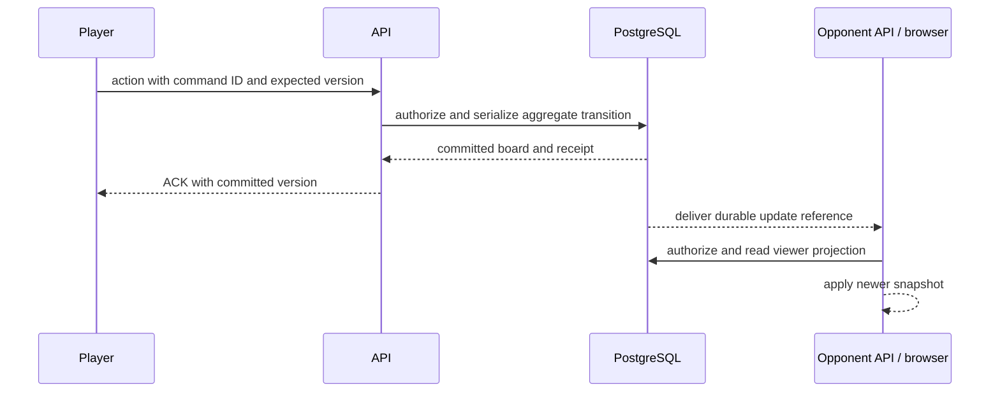
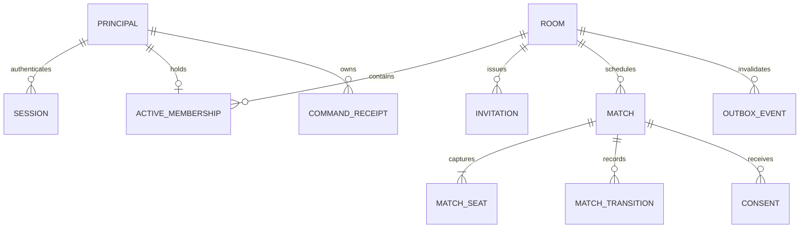

# System boundaries

The web app owns navigation, focus, theme and transient pending state. The API verifies a session at each private read and mutation. The rules package owns legal actions and natural outcomes. PostgreSQL owns persisted game state. The worker processes durable system transitions. Redis Streams carries cross-replica update signals. On gaps, clients apply fresh viewer-authorized snapshots.

| Record | Ownership |
|---|---|
| Principal, session and bootstrap proof | Session lifecycle |
| Room, roster, invite and consent | Room lifecycle |
| Match, ordered action and terminal result | Versioned game transition |
| Command receipt and event/deadline delivery | Transaction, recovery and worker |

The [data and wire requirements](../MEGA_PROMPT.md#6-repository-persistence-and-transactional-design) and the migrations are the implementation references. Private catalog exception is limited to the safe public game metadata. Game rules never fetch a board from transport or storage.

## Trust boundary review

| Boundary | Protected data | Required behavior and evidence |
|---|---|---|
| Browser to API/Socket.IO | Session, invite, seat and current view | Credential cookie, origin checks, strict input, viewer authorization on every private projection. Exercise outsider and revoke cases. |
| API to PostgreSQL | Roles, board, receipts and first terminal result | Transaction revalidation, parameterized queries, unique keys, scoped projections and reproducible replay. |
| API replicas and worker | Presence and update signals | Opaque identifiers, bounded retries, coherent snapshots and no winner from unverifiable presence. |
| Evidence and operations | Logs, test output, metrics and backups | Use synthetic data. Redact cookies and invite URLs. Keep metrics access private. |

Residual items to assess at release include partition behavior, secret rotation, restore drill, dependency review, abuse thresholds and assistive-technology review.

## Logical record relationships

These relationships describe the application model. The storage adapter persists keyed collections with per-aggregate transactional guards. Physical indexes and outbox columns are in the migrations.

[Transactional aggregate storage decision](../adr/0002-aggregate-storage.md)
